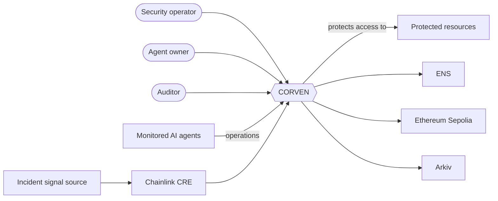
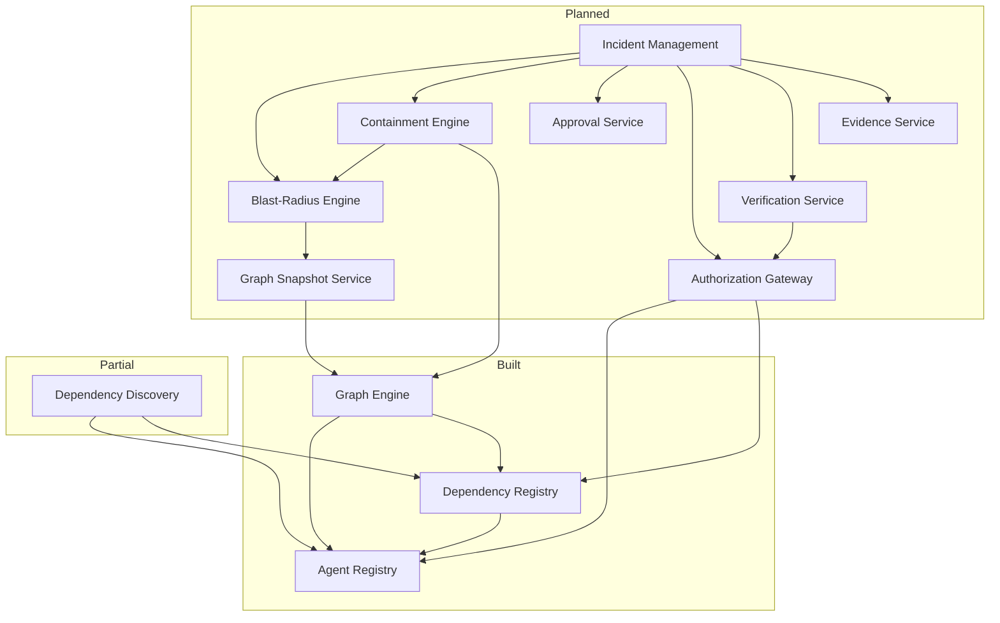

# System Architecture

**Style:** modular monolith. One deployable API, with domain modules that have explicit interfaces and one-directional dependencies. External systems (blockchain, ENS, Arkiv, Chainlink CRE) sit behind adapters.
**Source of truth for the visual model:** the C4 model in IcePanel (landscape `yngAt5NE5oF5SlvQ05qT`), imported from [icepanel/model-v2.json](icepanel/model-v2.json). This document is the written form; if they disagree, fix both.

## Context

Everything to the right of CORVEN other than the resources is external. CORVEN can only enforce on resources and operations routed through its own enforcement points.

## Layers

| Layer | Responsibility | State |
|---|---|---|
| Application (web) | Dashboard: graph, incidents, approval, evidence | Planned |
| API and orchestration | HTTP, authentication, validation, incident orchestration, audit | API built; orchestration planned |
| Domain modules | Registries, graph, incident, blast radius, containment, gateway, approval, verification, evidence | Registries and graph built |
| Integration adapters | Ethereum, ENS, Arkiv, Chainlink CRE | Planned |
| Data | PostgreSQL is the operational source of truth | Built |

PostgreSQL stays authoritative for application state. Blockchain and Arkiv add verifiability and persistence; they do not replace database queries.

## Module dependencies

Dependencies point one way. Lower layers never import higher ones.

Rules that are enforced by code structure today:

- Dependency Discovery writes **only** through `DependencyRegistryWriter`, never to dependency tables.
- The Graph Engine reads registry data through a read-only adapter inside one `REPEATABLE READ` transaction and never writes.
- Agent Registry and Dependency Registry do not depend on discovery or graph code.

## Cross-cutting concerns

| Concern | Approach | State |
|---|---|---|
| Tenancy | Every query is scoped by `organization_id` taken from the authenticated principal; cross-organization ids return 404 | Built |
| Authentication | `Authenticator` interface; production implementation absent, dev header adapter only | **Gap** |
| Authorization | Role-based permissions checked in services | Built (admin, operator, viewer, internal system) |
| Auditability | Append-only status history, audit logs, dependency versions and evidence, enforced by database triggers | Built |
| Errors | One envelope, stable codes, no internals to clients | Built |
| Determinism | Sorted adjacency, stable ordering, bounded searches | Built for the graph |
| Background work | pg-boss with a transactional outbox | Planned |

## Open architecture decisions

These were raised while modelling the architecture and are still open. Each is currently modelled with the stated default.

| # | Decision | Default in the model |
|---|---|---|
| 1 | Is the Authorization Gateway inside the API process, or a separately reachable enforcement point that agents call directly? | Inside the API |
| 2 | Which store does the gateway treat as the permission source of truth: PostgreSQL or the on-chain contracts? | Undecided (the PRD says the database is the source of truth for application state, but also has contracts enforcing permission state) |
| 3 | Which way does Chainlink CRE connect: to the contracts, to the API, or both? | Both are drawn; pick one |
| 4 | Are the graph and containment engines components of the API (as built) or separate containers? | Components |
| 5 | Who owns the evidence signing key, and where is it stored? | Unspecified |
| 6 | Dashboard authentication and roles | Unspecified; no identity provider chosen |

## Related documents

[container architecture](02-container-architecture.md) · [module architecture](03-module-architecture.md) · [data architecture](05-data-architecture.md) · [security architecture](06-security-architecture.md) · [sequence diagrams](07-incident-sequence-diagrams.md)
