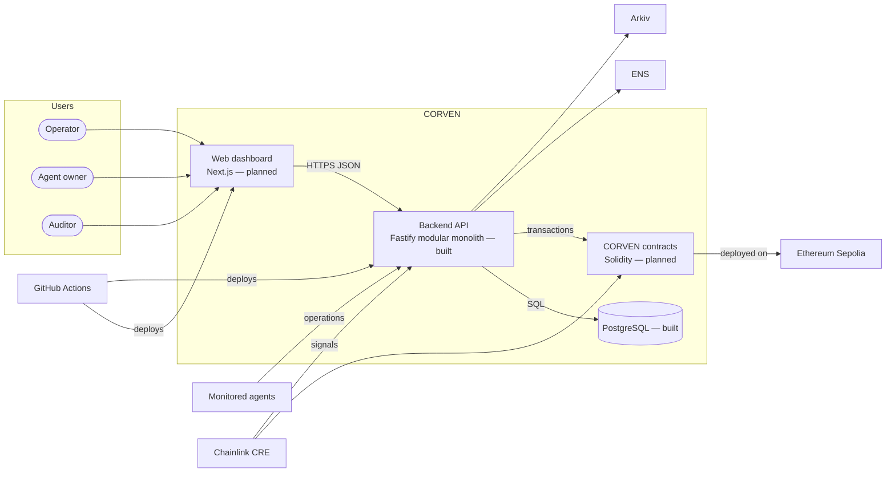

# Container Architecture (C4 Level 2)

## Containers

| Container | Technology | Responsibility | State |
|---|---|---|---|
| Backend API | Node.js 24, TypeScript, Fastify 5, Drizzle | All domain modules and integration adapters, one process | Built (registries, graph) |
| PostgreSQL | PostgreSQL 17 | Operational state, history, audit, evidence | Built |
| Web dashboard | Next.js, React Flow | Operator interface | Planned |
| CORVEN contracts | Solidity, Foundry, Ethereum Sepolia | On-chain permission state and response events | Planned |
| Landing page | Static HTML/CSS | Public description of the project | Built (`apps/landing`) |

## Communication

| From → to | Style | Notes |
|---|---|---|
| Dashboard → API | Synchronous HTTPS, JSON | Same envelope and error codes as the current API |
| API → PostgreSQL | Synchronous SQL | Transactions for every state change with its history and audit rows |
| API → contracts | Blockchain transactions (asynchronous confirmation) | "Submitted" is never reported as "executed" |
| API → ENS / Arkiv | Synchronous calls behind adapters | Failures reported, never swallowed |
| Agents → API (gateway) | Synchronous operation requests | Decision 1 in the system architecture is open |
| Background jobs | pg-boss over PostgreSQL | Planned for discovery and integration retries |

## Data ownership

| Data | Owner |
|---|---|
| Agents, capabilities, identities, status history | Agent Registry |
| Resources, dependencies, versions, evidence | Dependency Registry |
| Graph | Derived on demand from the registries; owned by nobody, stored nowhere |
| Incidents, plans, approvals, execution and verification results | Incident Management and its services (planned) |
| Evidence records | Evidence Service (planned) |

## Trust boundaries

1. Internet ↔ API (all external input is untrusted and validated).
2. API ↔ monitored agents and protected resources (CORVEN controls only what routes through it).
3. API ↔ external services (ENS, Arkiv, chain, CRE): responses are validated and failures handled explicitly.
4. Operator ↔ privileged actions (recovery, approval) behind roles.

See [06-security-architecture.md](06-security-architecture.md).
