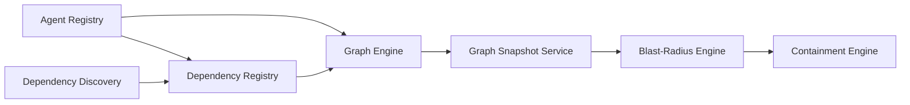

# Module Architecture

Ten domain modules plus four integration adapters, in one backend. Each module has routes, services, a repository, policies and tests, and talks to others through the interfaces below.

## Conventions (as implemented)

```text
modules/<name>/
├── routes/        HTTP + schemas only
├── controllers/   DTO mappers
├── schemas/       TypeBox request/response schemas (unknown fields rejected)
├── services/      business logic and transactions
├── repositories/  SQL only, always organization-scoped
├── policies/      rules that must live in one place (e.g. status transitions)
└── types/
```

Controllers are thin, services own transactions, repositories own SQL, and rules live in policies. The Graph Engine additionally keeps a `core/` that is pure TypeScript with no Fastify or database imports.

## Modules

| # | Module | State | Document |
|---|---|---|---|
| 1 | Agent Registry | Built | [01-agent-registry](../modules/01-agent-registry.md) |
| 2 | Dependency Registry | Built | [02-dependency-registry](../modules/02-dependency-registry.md) |
| 3 | Graph Engine | Built | [graph-engine/](../modules/graph-engine/README.md) (index: [03-graph-engine](../modules/03-graph-engine.md)) |
| – | Dependency Discovery | Partial | covered in [02-dependency-registry](../modules/02-dependency-registry.md) §16 and below |
| – | Graph Snapshot Service | Planned | described below; no document yet |
| 4 | Incident Management | Planned | [04-incident-management](../modules/04-incident-management.md) |
| 5 | Blast-Radius Engine | Planned | [05-blast-radius-engine](../modules/05-blast-radius-engine.md) |
| 6 | Containment Engine | Planned | [06-containment-engine](../modules/06-containment-engine.md) |
| 7 | Authorization Gateway | Planned | [07-authorization-gateway](../modules/07-authorization-gateway.md) |
| 8 | Approval Service | Planned | [08-approval-service](../modules/08-approval-service.md) |
| 9 | Verification Service | Planned | [09-verification-service](../modules/09-verification-service.md) |
| 10 | Evidence Service | Planned | [10-evidence-service](../modules/10-evidence-service.md) |

Numbering note: the PRD numbers the Graph Engine "Module 4"; the files under `modules/` follow the PRD's original ten-module list, where the graph is third.

## Responsibility chain from registry to containment

Each module owns one thing and depends only on those before it. Responsibilities are deliberately not merged.



| Module | Owns | Does not do |
|---|---|---|
| Agent Registry | Authoritative agent inventory: identity references, lifecycle status, capabilities | Dependencies, graph structure |
| Dependency Discovery (partial) | **Discovers and proposes** relationships from configurations, workflows and runtime events; normalization, resolution, reconciliation, review | Declare a relationship trusted; write dependency tables (it goes through `DependencyRegistryWriter`) |
| Dependency Registry | **Stores canonical accepted** relationships with provenance, confidence, versions, evidence; validates every relationship | Discover relationships; build or query graphs |
| Graph Engine | **Constructs and queries the structural graph** from canonical records; read-only | Write to registries; store graphs; classify impact; plan or enforce |
| Graph Snapshot Service (planned) | **Stores immutable point-in-time graph versions** (from the Graph Engine's export) so an incident is analysed against a fixed graph | Build graphs itself; interpret them |
| Blast-Radius Engine (planned) | **Analyzes potential impact** over a graph: compromised, exposed, potentially affected, healthy, uncertain | Plan or enforce |
| Containment Engine (planned) | **Calculates minimum-safe containment actions** from impact, constraints and enforcement points | Enforce (the gateway does); approve (a human does) |

Details of the built links: [Graph Engine](../modules/graph-engine/README.md) (position in CORVEN and interfaces), [Dependency Registry §16](../modules/02-dependency-registry.md).

## Interfaces between modules (implemented)

| Interface | Provider | Consumer | Purpose |
|---|---|---|---|
| `AgentRegistryReader` | Agent Registry | Discovery (future), Gateway (future) | `getAgent`, `listAgents`, `findAgentByExternalReference`, `getCapabilities`, `validateAgentReference`. Organization-explicit, read-only |
| `DependencyRegistryWriter` | Dependency Registry | Discovery | `createOrUpdate` (idempotent; created / updated / unchanged / rejected), `deactivate(reason)`, `findMatching`. Acts as the internal `system` principal |
| `DependencyGraphDataProvider` | Dependency Registry | Read-only consumers needing active dependencies (none today; the Graph Engine does **not** use it) | `listActiveDependencies`, `getDependency` |
| `RegistryGraphInputProvider` | Graph Engine adapter | Graph Engine | One consistent read-only snapshot (one `REPEATABLE READ` transaction) of agents, resources and dependencies of all statuses |
| `GraphQueryService` | Graph Engine | HTTP layer, Blast-Radius, Containment, Snapshot | `build(organizationId)` and the pure query functions over an immutable `Graph` |

## Interfaces between modules (planned)

| Interface | Provider | Consumer |
|---|---|---|
| `BlastRadiusService.analyze(graph, incident)` | Blast-Radius Engine | Incident Management, Containment |
| `ContainmentPlanner.plan(input)` | Containment Engine | Incident Management |
| `EnforcementPoint.apply / revoke / check` | Authorization Gateway adapters | Incident Management, Verification |
| `ApprovalService.request / decide` | Approval Service | Incident Management |
| `Verifier.run(plan)` | Verification Service | Incident Management |
| `EvidenceRecorder.append(stage, payload)` | Evidence Service | every stage |

## Dependency Discovery (partial)

Built: the registry-side prerequisites (agent and resource `externalReference`, append-only `dependency_evidence`, `DependencyRegistryWriter`, `AgentRegistryReader`, the `system` principal).
Not built: discovery sources and runs, adapters (agent configuration, workflow definition, runtime gateway), normalization, entity resolution, confidence rules beyond "strongest evidence wins", reconciliation (new / unchanged / modified / missing / conflicting / stale / unresolved), human review, pg-boss jobs.
Rule that is already enforced: discovery cannot create an authority edge from configuration, workflow or runtime evidence alone. It needs manual or permission-configuration evidence, or an approved review.

## Integration adapters (planned)

Each external system sits behind a small adapter interface so core logic is testable without it: [Ethereum](../integrations/01-ethereum-integration.md), [ENS](../integrations/02-ens-integration.md), [Arkiv](../integrations/03-arkiv-integration.md), [Chainlink CRE](../integrations/04-chainlink-cre-integration.md).

## Rules to keep

1. No module imports a module above it in the dependency diagram.
2. Core algorithms (graph, blast radius, containment) stay free of Fastify, database and chain imports so they run in unit tests without external services.
3. Cross-module writes go through the owning module's service boundary, never its tables.
4. Every state change writes its history and audit rows in the same transaction.
