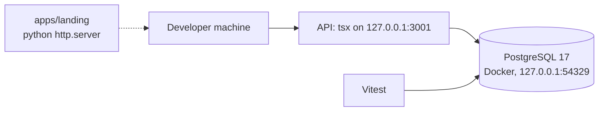
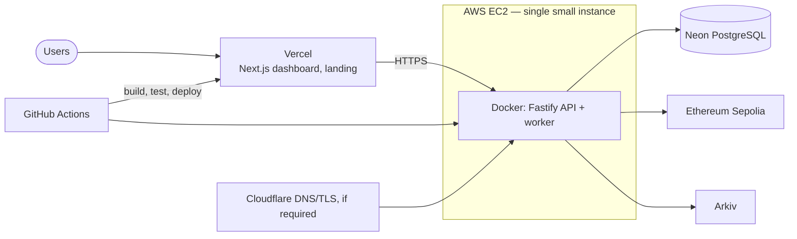

# Deployment Architecture

**State:** local development works today. Cloud deployment is **planned and not done**. The API must not be deployed publicly until real authentication exists (see below).

## Environments

| Environment | Purpose | State |
|---|---|---|
| Local | Development and tests | Working: Docker Compose PostgreSQL, API via `tsx`, Vitest |
| Testnet demo | Public demonstration with Sepolia contracts | Planned |
| Production | Not in scope for the hackathon | None |

## Local topology (actual)

PostgreSQL binds to `127.0.0.1` only. The credentials in `docker-compose.yml` are local-only throwaways. Tests create and drop their own throwaway database on that server.

## Planned cloud topology

| Component | Platform | Reason |
|---|---|---|
| Frontend and landing | Vercel | Static and Next.js hosting, no servers to run |
| API and worker | One small AWS EC2 instance, Docker | Hosts the monolith and the optional background worker without extra infrastructure |
| Database | Neon PostgreSQL | Managed PostgreSQL, free tier to start |
| Chain | Ethereum Sepolia | Testnet only |
| CI/CD | GitHub Actions | Lint, type-check, test, deploy |
| DNS/TLS | Cloudflare if required | HTTPS for the API |

Not used on purpose: Kubernetes, managed queues, load balancers and other services that add cost without helping the demo.

## Deployment acceptance criteria (from the PRD)

- Frontend publicly reachable; API reachable over HTTPS; health check available (`GET /health` exists).
- Database connectivity works and secrets are configured outside Git.
- Contracts deployed to Sepolia; integrations demonstrable.
- The full incident scenario works in the deployed environment.

## Prerequisites before any public deployment

1. **Real authentication and organizations.** Today only a fail-closed default and a development header adapter exist. `server.ts` refuses to start the dev adapter when `NODE_ENV=production`, so a production process currently rejects every request with 401. This is deliberate.
2. TLS in front of the API; secrets from the platform's secret store.
3. CI that runs lint, type-check and tests (no CI exists yet).
4. Budget alerts and a shutdown plan for AWS credits (about $100, subject to eligibility and expiry).
5. A migration run step (`pnpm --filter @corven/api db:migrate`) in the deploy procedure, with the manual down scripts understood as destructive.

See [operations/01-infrastructure-plan.md](../operations/01-infrastructure-plan.md) and [operations/02-deployment-guide.md](../operations/02-deployment-guide.md).
