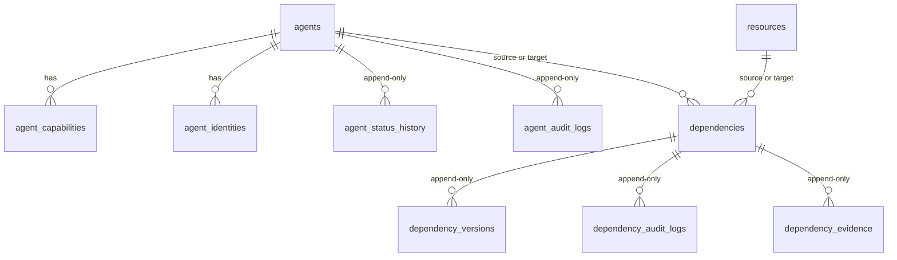

# Data Architecture

PostgreSQL is the operational source of truth. This document describes the data model as it exists in migrations `0000` to `0005`; the column-level reference is [engineering/01-database-schema.md](../engineering/01-database-schema.md).

## Entity relationships (built)

## Design rules

| Rule | How it is applied |
|---|---|
| Every row belongs to one organization | `organization_id` on every table; every query filters on it |
| Cross-organization references are impossible | Composite foreign keys `(id, organization_id)` from child tables to `agents`, `resources` and `dependencies` |
| History is never edited | Triggers reject `UPDATE`, `DELETE` and `TRUNCATE` on status history, audit logs, dependency versions, audit logs and evidence |
| Nothing is hard-deleted | Foreign keys are `ON DELETE RESTRICT`; "removal" is a soft state change recorded as an event |
| A state change and its record commit together | One transaction writes the row, the version or history row and the audit row, with the parent row locked (`SELECT … FOR UPDATE`) |
| Invalid states are rejected twice | The application validates first; CHECK constraints repeat the key rules |
| Timestamps | `timestamptz`; `updated_at` set by the application on every write |

## Polymorphic references

A dependency endpoint is either an agent or a resource. A bare UUID plus a type column cannot be a real foreign key, so each side has **separate columns** (`source_agent_id` / `source_resource_id`, `target_agent_id` / `target_resource_id`), each with its own composite foreign key, and a CHECK that exactly the column matching the declared type is set. Generated columns `source_id` and `target_id` give one id to filter on. This is enforced by PostgreSQL and tested with raw SQL that bypasses the application.

## Uniqueness

| Rule | Scope |
|---|---|
| Agent name | per organization, case-insensitive |
| Agent and resource `externalReference` | per organization, case-insensitive, only when set |
| Identity (type, value, chain) | per organization |
| Dependency | one per ordered pair and type, regardless of status |
| Evidence | one per dependency, discovery run, source type and source reference (retries cannot duplicate) |

## Derived data

The dependency graph is **not stored**. It is rebuilt from agents, resources and dependencies on each request inside a read-only `REPEATABLE READ` transaction, so it is always current. A future Graph Snapshot Service would persist immutable snapshots for incidents.

## Planned data

| Table family | Purpose | Module |
|---|---|---|
| `discovery_sources`, `discovery_runs`, `discovery_observations`, `discovery_reviews`, `discovery_reconciliation_results` | Discovery state | Dependency Discovery |
| `graph_snapshots` | Immutable graph captured at incident time | Graph Snapshot |
| `incidents`, `incident_events` | Incident and timeline | Incident Management |
| `containment_plans`, `containment_actions` | Plans and their actions | Containment |
| `approvals` | Decisions bound to a plan hash | Approval |
| `execution_records`, `verification_results` | What was applied and what was observed | Gateway, Verification |
| `evidence_records` | Hash-linked records | Evidence |
| `users`, `organizations`, `memberships` | Real authentication and tenancy | Auth |

## Retention and privacy

Nothing is purged today. Metadata fields are guarded against secret-looking keys (by key name only). Credentials and private keys must never be stored in metadata, provenance references or notes. A retention policy for discovery raw payloads is a requirement of the discovery module and is not written yet.
