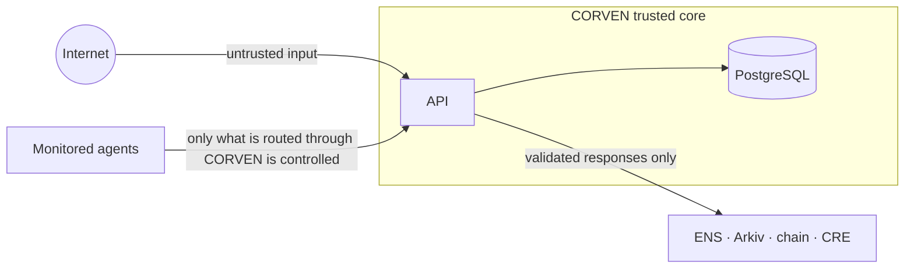

# Security Architecture

CORVEN is security infrastructure, so it has to be defended itself. This document records the trust boundaries, the controls that exist and the ones that do not. The threat analysis is in [engineering/06-threat-model.md](../engineering/06-threat-model.md).

## Trust boundaries

## Controls implemented

| Area | Control |
|---|---|
| Tenant isolation | `organization_id` comes only from the authenticated principal; every repository query filters on it; cross-organization ids return 404 (no existence oracle); composite foreign keys block cross-organization references in the database |
| Authorization | Role permissions checked in every service (`admin`, `operator`, `viewer`, internal `system`); recovery of a compromised agent is admin-only, and every exit from `compromised` counts as a recovery |
| Input validation | TypeBox schemas on every request; unknown fields are rejected (400), so mass-assignment attempts are visible; identifiers and enums validated |
| Output control | Response schemas act as allow-lists; errors never include SQL, constraint names or stack traces; unexpected failures return a generic 500 and are logged with their cause server-side only |
| Integrity of history | Append-only versions, status history, audit logs and evidence, enforced by database triggers; agents, resources and dependencies cannot be hard-deleted |
| Atomicity | State change, history and audit rows commit in one transaction with the row locked; concurrency tests exist for status changes, dependency updates, authority-cycle creation and discovery writes |
| Secrets hygiene | Metadata guard rejects secret-looking keys (best effort, key names only); no secrets in logs; local DB credentials are throwaway |
| Boundedness | Traversal depth, path and cycle enumeration have hard limits and a search budget; graph size is capped |
| Internal actor | The discovery writer uses a `system` principal that can write dependencies only, and `x-dev-role: system` is rejected over HTTP |
| Fail-closed default | With no authenticator configured, every request is 401; the dev adapter refuses to start in production |

## Gaps (do not claim otherwise)

| Gap | Impact |
|---|---|
| **No real authentication, users or organizations** | The API is unsafe to expose. The dev adapter trusts request headers |
| No rate limiting | Brute force and abuse are not throttled |
| No CI or dependency scanning | Vulnerable dependencies would go unnoticed |
| Secret detection is name-based | A secret stored under an innocent key is not caught |
| No audit read endpoint | Auditors cannot browse audit rows through the API yet |
| Evidence is append-only but not hashed or signed | Tampering by someone with database superuser rights is not detectable yet |
| No TLS, secrets management or hardening docs | Part of the deployment work |

## Controls planned

| Area | Control |
|---|---|
| Authentication | Real identity provider, short-lived tokens, protected approval and recovery operations |
| Approval | Bound to the exact plan version and action set; any plan change invalidates it |
| Runtime evidence | Authenticated gateway event producers, unique event ids, signature or service-identity checks, distinct recording of attempted, denied, allowed and completed outcomes |
| Evidence | Canonical hashing, hash chaining, signing, independent verification, anchoring |
| Smart contracts | Explicit access control, validated state transitions, replay protection, safe signature verification, expiry and revocation checks, adversarial tests |
| Sources | Treat configurations and workflows as untrusted; no arbitrary URL fetching; no path traversal; credentials outside ordinary JSON |
| LLM boundary | An LLM may help explain or interpret, but must not invent dependencies, decide ownership, approve relationships, override deterministic validation, change permissions or trigger containment |

## Principles

1. Deterministic enforcement: security decisions do not depend solely on an AI model.
2. Fail closed: an unreachable authenticator, enforcement point or verifier never results in "allowed" or "contained".
3. Never report success without verification: planned, approved, submitted, executed and verified are different states.
4. A partial response is never reported as contained.
5. Absence of evidence is not evidence of absence: a dependency that was not observed has not been removed.
