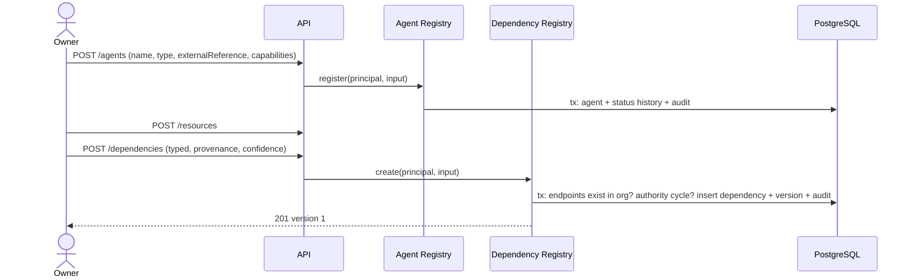
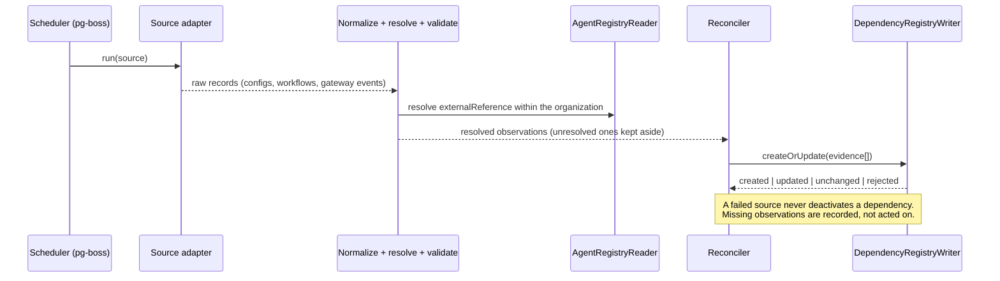
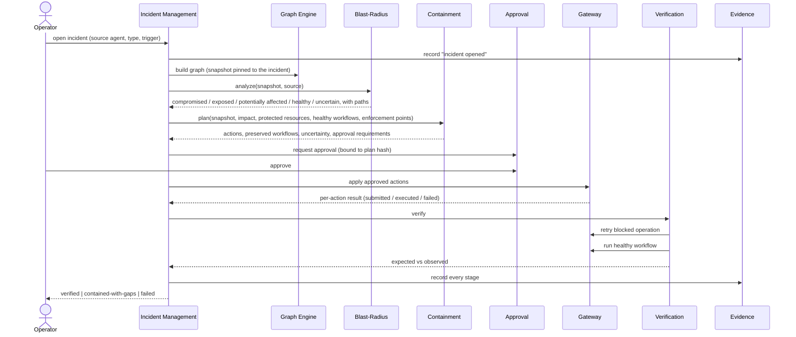
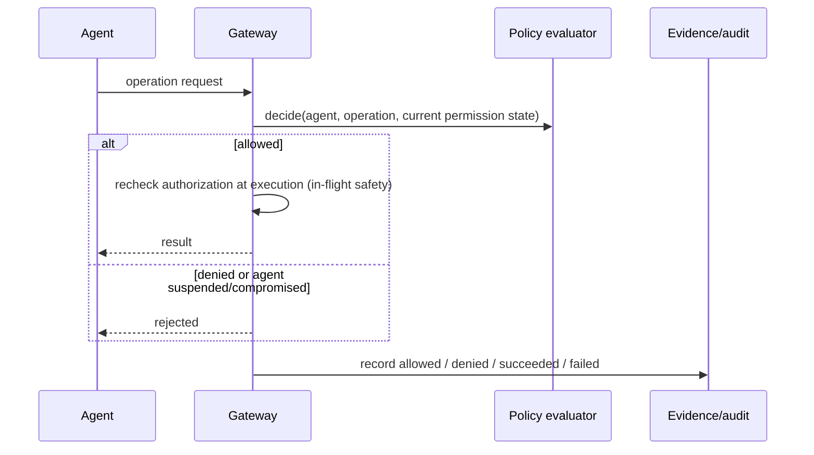
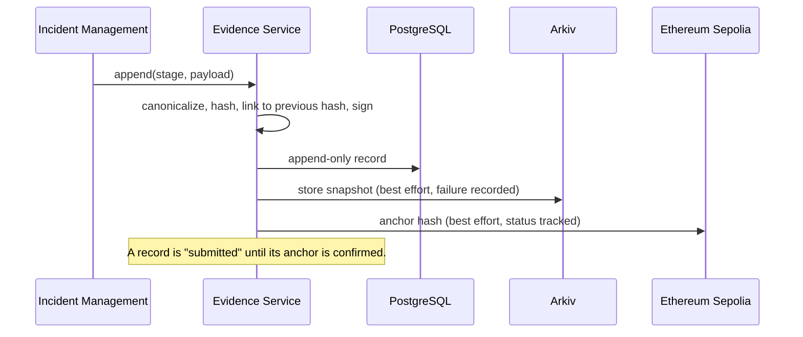

# Incident Sequence Diagrams

Legend: solid steps marked **[built]** exist today; steps marked **[planned]** are designs. Participant names match the modules in [03-module-architecture.md](03-module-architecture.md).

## 1. Registration and dependency recording [built]

## 2. Automated discovery [planned; registry side built]

## 3. Incident response, end to end [planned]

## 4. Authorization at the enforcement boundary [planned]

A gateway failure or an unreachable policy store denies the operation (fail closed).

## 5. Evidence and anchoring [planned]

## 6. Failure paths to handle

| Failure | Required behavior |
|---|---|
| Authenticator unavailable | 401 for everything (fail closed) |
| Chain transaction fails or is dropped | Action stays "submitted/failed", incident is not "contained" |
| Arkiv or ENS unavailable | Reported, retried; core incident flow continues with the gap recorded |
| Partial containment | Incident ends `contained-with-gaps` or `failed`, never `verified` |
| Verification fails | Reported with expected vs observed; actionable next step; incident not marked verified |
| Approval rejected or plan changed | Plan cannot execute as approved |
