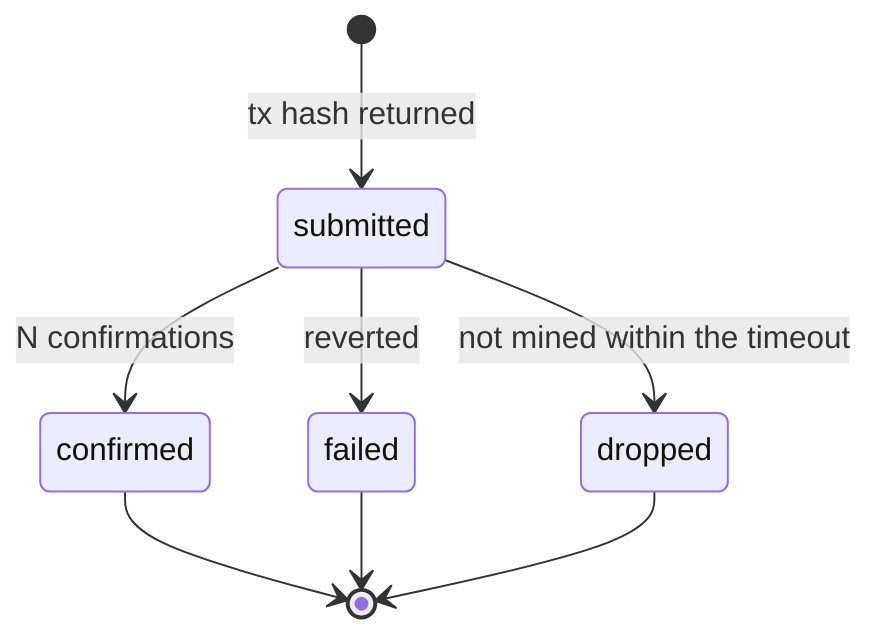

# Ethereum Integration

**Status: planned (design).** Nothing is implemented. Network: **Ethereum Sepolia** (testnet only).

## Purpose

Support the incident workflow on-chain in three ways: execute authorization changes recorded in the permission contract, emit events that act as verifiable response evidence, and provide transaction references for evidence records. The integration must serve the core product; it is not there to satisfy a checklist.

## Adapter interface

The rest of the code talks to an interface, never to a chain library, so core logic is testable without a node.

```ts
interface ChainAdapter {
  submit(call: ContractCall): Promise<SubmittedTx>;        // returns a tx hash, not success
  getStatus(txHash: string): Promise<TxStatus>;            // pending | confirmed | failed | dropped
  read<T>(call: ContractRead): Promise<T>;
  getEvents(filter: EventFilter): Promise<ChainEvent[]>;
}
```

Implementations: a real adapter (viem or ethers over an RPC provider) and an in-memory fake for tests. Local development uses Anvil.

## Transaction lifecycle



An action is `submitted` after the hash is returned and only becomes `executed` when the transaction is confirmed. **Submission is never reported as containment.** `failed` and `dropped` are recorded and make the incident `failed` or partial.

## Rules

- RPC provider failure, a reverted transaction, a dropped transaction and a reorg are explicit, recorded outcomes.
- Confirmation depth is configurable; the default is recorded in the evidence.
- Idempotency: the same action is not submitted twice (action id in the contract call or a local idempotency key); a retry checks the previous transaction first.
- Gas funding, nonce management and the executor key are operational concerns: the key is never committed and never logged.
- What goes on-chain: permission state changes and event references keyed by hashed identifiers, plus optionally an evidence chain head hash. No secrets, no personal data.

## Configuration (planned)

`SEPOLIA_RPC_URL`, `CHAIN_ID`, contract address, executor key reference, confirmation depth, transaction timeout. See [operations/03-environment-configuration.md](../operations/03-environment-configuration.md).

## Testing

Unit tests against the fake adapter (every lifecycle state, including dropped and reorged); integration tests against Anvil; contract tests in Foundry ([engineering/05-smart-contract-design.md](../engineering/05-smart-contract-design.md)).

## Limits

Completed blockchain transactions cannot be reversed by CORVEN. On-chain revocation affects only systems that consult the contract. Sepolia is a testnet with no value guarantees and occasional instability.

## Open decisions

Whether the chain is the permission source of truth ([architecture/01-system-architecture.md](../architecture/01-system-architecture.md), decision 2); chain library choice; who funds and holds the executor key.
