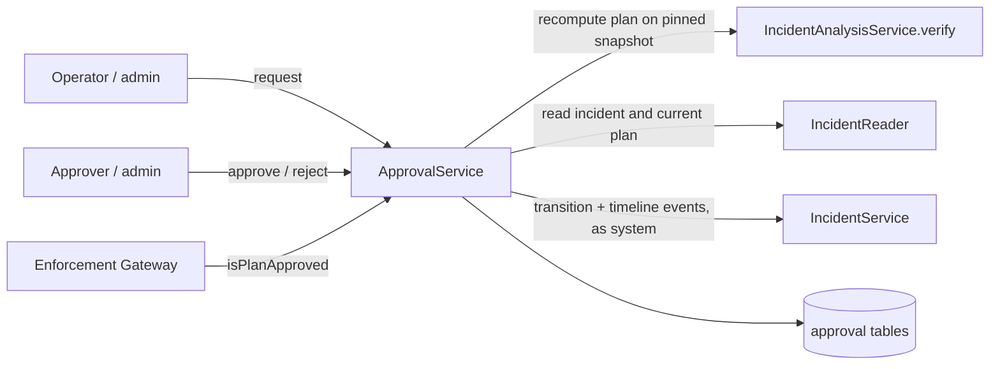
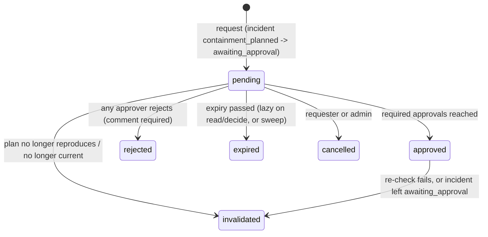

# Approval Service: architecture

Dependencies point one way: Approval depends on Incident Management; the Gateway depends on Approval only through its `ApprovalVerifier` interface. There is no cycle.

## Workflow

| Approval status | Incident effect (written as the `system` principal) |
|---|---|
| pending | incident `containment_planned -> awaiting_approval`, written by the requester; timeline `approval.requested` with the plan hash |
| approved | `awaiting_approval -> approved` with `{approvalId, planHash, approvalDigest, deciders}`; `approval.granted` |
| rejected | `awaiting_approval -> rejected`; `approval.rejected` |
| expired / cancelled | `awaiting_approval -> investigating`; `approval.expired` / `approval.cancelled` |
| invalidated | from `awaiting_approval` or `approved` back to `investigating`; `approval.invalidated` |

## Synchronising the incident, and recovering

Decisions are committed in the approval tables first. Updating the incident is a second step in another module's transaction. Every write in that step uses an idempotency key derived from the approval id (`approval:<id>:approved`, ...), so it can be repeated. If it fails, the approval keeps `incident_synced = false` and `runMaintenance()` retries it; the test suite injects a failure and shows the sweep completing it with no duplicate events.

If the incident left `awaiting_approval` before an approval completed (for example a person withdrew the request), the approval is **invalidated** rather than applied.

If moving the incident into `awaiting_approval` fails when a request is made, the request is cancelled immediately, so nothing stays pending for a plan nobody is waiting on.

`runMaintenance()` also expires overdue pending requests. It is safe to run repeatedly and concurrently. Scheduling it (pg-boss) belongs to the orchestration stage; until then, expiry is also applied lazily whenever a request is read or decided.

## Concurrency

Every decision locks the request row. Concurrent final approvals: exactly one decides, the rest receive `APPROVAL_NOT_PENDING` (tested with six approvers). One pending request per incident is enforced by a partial unique index.
