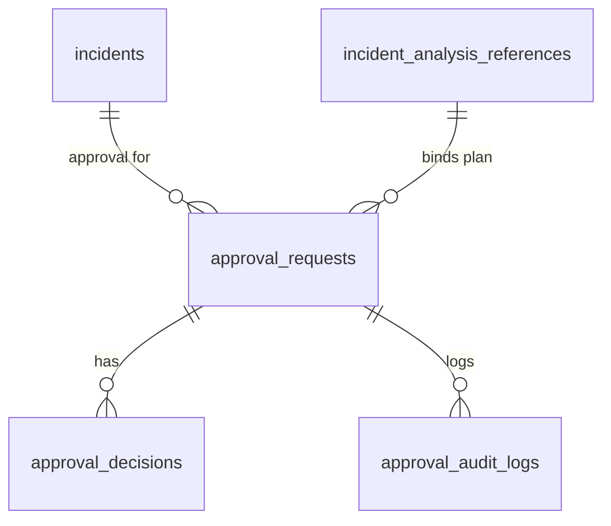

# Approval Service: data model

Migrations `0014_approval_service` and `0015_approval_append_only` (down scripts included). `0014` also adds a unique `(id, organization_id)` to `incident_analysis_references` so requests can reference a plan with a composite foreign key.

| Table | Mutability | Contents |
|---|---|---|
| `approval_policies` | upsert (audited) | one row per organization |
| `approval_requests` | status and decision fields only; the binding is frozen by a trigger; a decided request cannot change status except `approved -> invalidated` | incident, plan reference (FK), plan version, plan hash, snapshot hash, result hash, schema version, approval digest, risk and reasons, policy copy, required approvals, status, requester, expiry, decision time, execution window end, closing reason, `incident_synced` |
| `approval_decisions` | append-only; one per approver per request | decision, approver, role, comment, plan hash and digest that were reviewed |
| `approval_audit_logs` | append-only, ordered by `seq` | requested, decision recorded, approved, rejected, expired, cancelled, invalidated, policy changed |

A partial unique index allows one pending request per incident.

