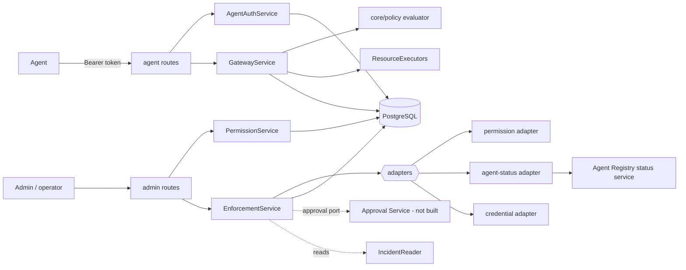

# Gateway architecture

## Placement decision

The gateway runs **inside the API process**, as a module. A separately reachable enforcement point would be a cleaner trust boundary, but only matters once resources are actually proxied; the service interfaces (`GatewayService`, `EnforcementService`, `ResourceExecutors`) are the seam where it can be split out. PostgreSQL is the **permission source of truth**; no blockchain call sits on the synchronous decision path.



## Request flow: `POST /gateway/execute`

```mermaid
sequenceDiagram
  participant A as Agent
  participant GW as Gateway
  participant DB as PostgreSQL
  participant X as Resource executor
  A->>GW: Bearer token + {requestId, resource, action, payload}
  GW->>DB: verify token, credential still active
  GW->>DB: claim execution record (pending) - at most once
  GW->>DB: load agent, grants, restrictions; evaluate; record decision (precheck)
  alt denied
    GW->>DB: finalize denied
    GW-->>A: 403 OPERATION_DENIED + reason codes
  else allowed
    GW->>DB: reload state; evaluate; record decision (recheck)
    alt revoked meanwhile
      GW->>DB: finalize denied (REVOKED_BEFORE_EXECUTION)
      GW-->>A: 403
    else still allowed
      GW->>X: execute(context incl. permission id + version)
      X-->>GW: executed | submitted | error
      GW->>DB: finalize executed | submitted | failed
      GW-->>A: 200 | 202 | 502
    end
  end
```

## In-flight recheck and its limit

The re-check runs after the pre-check and immediately before the executor is called. A revocation committed before the re-check reads the grants wins (tested with a hook that revokes in between). There is still a window of milliseconds between the re-check and the resource acting on the call. For resources that can verify atomically, the executor receives `authorization.permissionId` and `permissionVersion` (the version rises when a permission is revoked) so the resource can reject a stale authorization itself. Resources that cannot do this have a residual time-of-check/time-of-use window; revocation will apply to every later request.

## Fail-closed behaviour

| Failure | Result |
|---|---|
| No signing key configured | token issuance and every gateway call: 503 `AGENT_AUTH_UNAVAILABLE` |
| Storage error while authenticating or deciding | 503 `ENFORCEMENT_UNAVAILABLE`; executor not called; record marked `failed` if the database allows |
| Crash after claiming a request id | the row stays `pending`; the request id is never executed again (`EXECUTION_IN_PROGRESS`): unknown outcome is not retried |
| No executor for a resource | `failed` / `EXECUTOR_NOT_CONFIGURED`, never `executed` |
| No adapter for an enforcement action | `unsupported`, never `executed` |
| Approval verifier unavailable or absent | plan-based enforcement refused |

## Probe (for Verification)

`GatewayService.probe(org, agentId, {resource, action})` evaluates the same decision path for the agent's current credential state and, if allowed, calls the executor's optional non-destructive `probe()`. Nothing is executed. See [../verification-service/test-types.md](../verification-service/test-types.md).

## Coverage

`GET /gateway/coverage` classifies each active dependency edge: `CONTROLLED`, `PARTIALLY_CONTROLLED`, `NOT_CONTROLLED`, `UNKNOWN`. `toContainmentCoverage()` converts the report into the Containment Engine's `coverage` input (uncontrollable edges are blocked from cuts; partially controlled edges cost 2). Details in [enforcement-adapters.md](enforcement-adapters.md).
