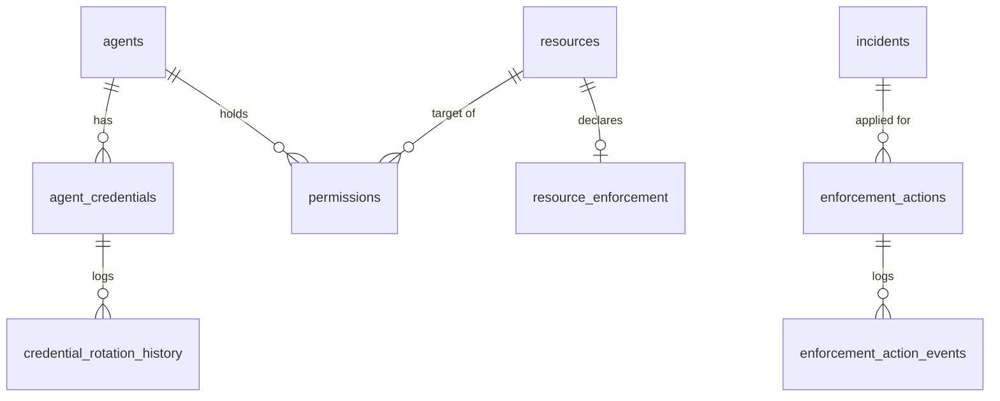

# Gateway data model

Migrations `0012_authorization_gateway`, `0013_gateway_append_only` (with down scripts). Composite `(id, organization_id)` foreign keys throughout; nothing is hard-deleted.

| Table | Mutability | Notes |
|---|---|---|
| `agent_credentials` | revoke only (trigger) | `secret_hash` (SHA-256 hex), `status`, `expires_at`; partial unique: one active per agent |
| `credential_rotation_history` | append-only | issued / rotated / revoked, actor, reason |
| `permissions` | revoke only (trigger; identity, action and constraints frozen) | `version` rises on revoke; partial unique: one active per agent/resource/action |
| `resource_enforcement` | upsert | `gateway` or `advisory` per resource |
| `gateway_audit_logs` | append-only | grants, revocations, mode changes, credential events |
| `gateway_decisions` | append-only | every `check`/`precheck`/`recheck` with reason codes, permission id and version, payload hash |
| `execution_records` | **finalized once** (trigger: only `pending` -> final) | unique `(org, agent, request_id)` is the at-most-once claim; `simulated` flag; bounded redacted result |
| `enforcement_actions` | status moves only; identity frozen (trigger) | kind, agent, resource, incident, plan hash, approval basis and reference, idempotency key |
| `enforcement_action_events` | append-only | every status an action passed through |

`TRUNCATE` is rejected on all of them. `incident_id` on `enforcement_actions` is a real composite foreign key to `incidents`.

