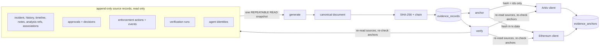
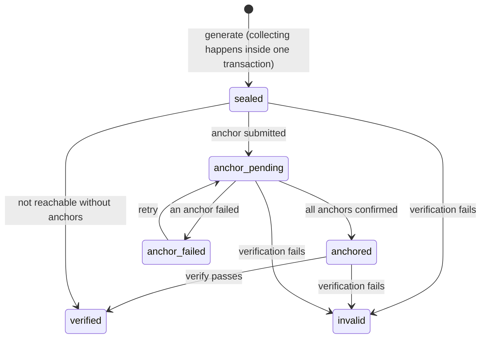

# Evidence architecture

## Lifecycle

`COLLECTING` and `GENERATED` from the brief happen inside the generating transaction and are not persisted states: a record either exists sealed or does not. `invalid` is terminal (database trigger). An anchoring failure never moves a record to `invalid`; it only affects the anchoring status.

## Behaviour

- **Consistency:** all sections are read in one `REPEATABLE READ` transaction, so they describe the same moment. Concurrent generation is serialized by the unique `(incident, sequence)` and retried.
- **Immutability:** `content`, `content_hash`, sequence and chain links are frozen by a trigger; nothing is deleted; verification logs are append-only.
- **A later record, not an edit:** the incident keeps moving after sealing. New activity goes in the next record, whose `previous` links to this one. Verification of an older record accepts later additions and rejects changes to what was sealed.
- **Timeline:** generating a record writes an `evidence.generated` event to the incident timeline (best effort; the record exists regardless).
