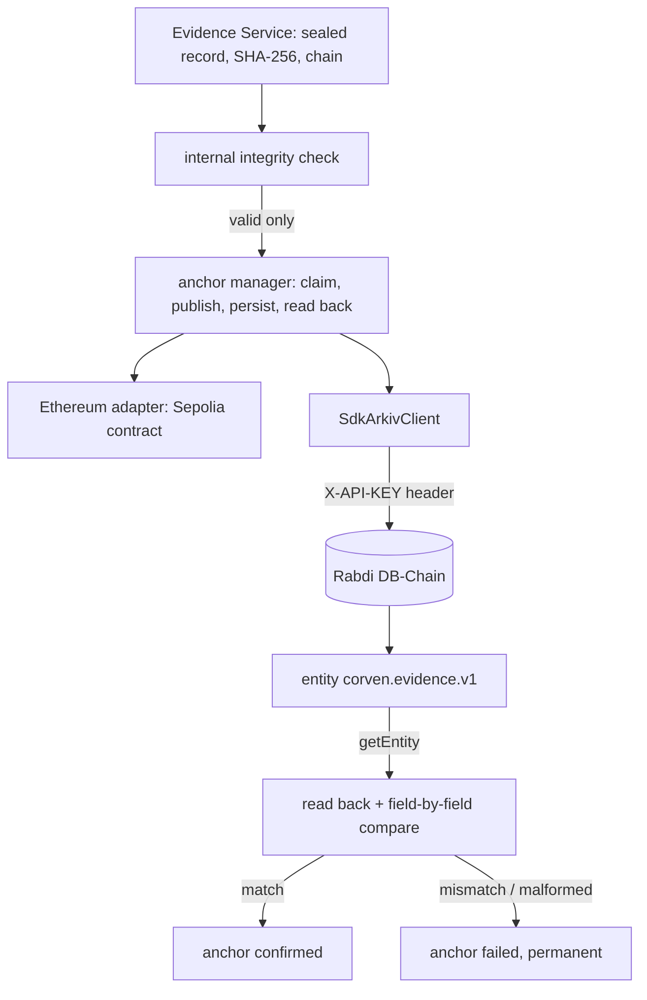

# Arkiv (Rabdi DB-Chain) integration

**Status: implemented and tested on Rabdi.** The integration uses the official SDK `@arkiv-network/sdk` **1.0.1** (pinned exactly) and has created, read back, queried and verified real entities on the Rabdi public testnet (chain id 7794095). See [Test results](#tests) for exactly what was exercised.

## Architecture



Arkiv and Ethereum stay separate: different clients, different confirmation rules, separate anchor rows. Arkiv is an external, verifiable copy of a commitment. It never decides whether an incident is safe, never bypasses approval, and its failure never makes internal evidence invalid.

## Network

| Item | Value |
|---|---|
| Network | Rabdi DB-Chain public testnet |
| Chain id | 7794095 (`0x76edaf`) |
| HTTP RPC | `https://rpc.rabdi.db-chain.testnet.arkiv.network` |
| Explorer | `https://rabdi.explorer.arkiv.network` |
| Currency | tGLM |

## Configuration

| Variable | Meaning |
|---|---|
| `ARKIV_ENABLED` | `false` disables the integration. Anything else leaves it on |
| `ARKIV_NETWORK` | must be `rabdi` |
| `ARKIV_CHAIN_ID` | must be 7794095 (the default) |
| `ARKIV_RPC_URL` | optional; if set it must be exactly the Rabdi endpoint (https, that host, no path, no credentials). Anything else is refused: an environment variable cannot point CORVEN at another host (SSRF) |
| `ARKIV_ACCESS_KEY` | Arkiv Hub access key for Rabdi. **Secret.** Sent only in the `X-API-KEY` header, never in a URL, so it cannot leak through URLs in SDK or transport errors |
| `ARKIV_SIGNER_PRIVATE_KEY` | Wallet that creates entities and pays tGLM. **Secret.** Without it Arkiv is read-only (health, read-back, queries still work) |
| `ARKIV_ALLOW_PUBLIC_ENDPOINT` | `true` explicitly allows the key-less public endpoint. **Development only** (see limits) |

Values live in the repository's root `.env` (git-ignored). `.env.example` lists the names with no values.

### States

`loadArkivConfig` returns `disabled`, `not_configured` (with the missing or invalid variables named, never their values) or `configured`. The server builds a real `SdkArkivClient` only from a `configured` state. **There is no fallback to an in-memory implementation**: with Arkiv disabled or not configured, anchoring to Arkiv answers `TARGET_NOT_CONFIGURED` and `GET /evidence/arkiv/health` says why.

Whether Arkiv actually works is decided by the health check, never by configuration: `operational`, `unavailable`, `auth_failed` or `wrong_network`.

## Entity schema `corven.evidence.v1`

Defined with the SDK's `defineSchema`. Every create also writes the SDK's indexed `arkiv.schema` tag.

| Column | Type | Indexed | Content |
|---|---|---|---|
| `evidenceRef` | str | yes | `sha256("corven.evidence.v1:" + evidenceUuid)` |
| `incidentRef` | str | yes | `sha256("corven.incident.v1:" + incidentUuid)` |
| `orgRef` | str | yes | `sha256("corven.org.v1:" + organizationUuid)` |
| `evidenceHash` | str | yes | the SHA-256 of CORVEN's canonical evidence document, exactly as sealed |
| `previousHash` | str | no | the previous record's hash in the incident chain, `""` for the first |
| `schemaVersion`, `sequence` | u64 | no | from the sealed record |
| `createdAt` | str | no | ISO time the record was sealed |
| `contentType`, `producer` | str | no | `application/json`, `CORVEN` |

References are one-way commitments: a reviewer holding a uuid can recompute them; the chain reveals no internal identifier. **Nothing else is uploaded**: no titles, descriptions, reasons, comments, notes, payloads, agent configuration, graph data, credentials or personal data. The hash is never recomputed for Arkiv; the sealed hash is stored as-is. Entities live about 180 days (the chain maximum is about 182).

## Creating an anchor

1. The record must pass CORVEN's internal integrity check, or anchoring is refused (`EVIDENCE_INVALID`) and nothing is published.
2. **Atomic claim** of the anchor row. Nobody else can be creating it, and a confirmed anchor is never touched.
3. `publish`: validates every field locally, then asks Rabdi (one keys-only query, then direct reads) whether this signer already has an entity for this evidence. If it exists with the same content, it is **reused** and nothing is created; with different content it is a hard error. Otherwise `createEntity`.
4. The entity key, transaction hash and expiry block are **persisted immediately**, before the read-back, so a crash or database error afterwards cannot lose them.
5. **Read back** with `getEntity` and compare every field. The hash is compared in constant time, and the owner must be this deployment's signer. Only an exact match sets `confirmed`.

Creating an entity, or sending a request, is never a confirmation.

## Retrieval and queries

| Need | How |
|---|---|
| By entity key | `getEntity(key, schema)`; a missing entity is `not_found` |
| By evidence | indexed `evidenceRef` |
| By incident | indexed `incidentRef` |
| By schema | `.from(EvidenceEntity)` filters on the `arkiv.schema` tag |

Everything read from Arkiv is untrusted. It is type-checked field by field; an entity that does not fit the schema is `malformed`, never coerced.

Endpoints:
- `GET /evidence/:id/arkiv` (evidence:read): the anchor plus a live read-back result.
- `GET /evidence/arkiv/incidents/:incidentId` (evidence:read; the incident must have evidence in your organization).
- `GET /evidence/arkiv/stats` (evidence:read).
- `GET /evidence/arkiv/health` (admin only; performs a live check).

## Status model

Anchor rows use the existing statuses plus retry state:

| Status | Meaning |
|---|---|
| (no row) | never attempted |
| `submitted`, no `externalReference` | claim in flight (an abandoned claim is taken over after 2 minutes) |
| `submitted`, with `externalReference` | entity created, not yet confirmed (for example not readable yet) |
| `confirmed` | read back and matched. Final (database trigger) |
| `failed`, `retryable = true` | transient; `nextAttemptAt` says when maintenance retries |
| `failed`, `retryable = false` | permanent (`ARKIV_READBACK_MISMATCH`, `ARKIV_MALFORMED_ENTITY`, `ARKIV_AUTH_FAILED`, ...) or retries exhausted |

Each row also carries `errorCode`, `attempts`, `lastAttemptAt`, `externalTx` and `externalExpiresBlock`. Evidence status (`anchor_pending`, `anchored`, `anchor_failed`, `verified`) is derived from all anchors; **internal validity is a separate concept** and is never changed by an Arkiv failure.

## Retries and reconciliation

The orchestrator's maintenance pass (driven by the existing pg-boss ticker) calls `EvidenceService.runMaintenance`, which works through due Arkiv anchors:
- failed, retryable and due;
- created but unconfirmed;
- abandoned claims.

| Code | Retry | Note |
|---|---|---|
| `ARKIV_NETWORK`, `ARKIV_TIMEOUT`, `ARKIV_RATE_LIMITED`, `ARKIV_TX_FAILED`, `ARKIV_NOT_INDEXED`, `ARKIV_UNKNOWN` | yes | backoff 30 s, doubling, capped at 30 min |
| `ARKIV_INSUFFICIENT_FUNDS`, `ARKIV_QUOTA_EXCEEDED` | yes | backoff starts at 5 min |
| `ARKIV_AUTH_FAILED`, `ARKIV_WRONG_NETWORK`, `ARKIV_NOT_CONFIGURED`, `ARKIV_DISABLED`, `ARKIV_INVALID_ENTITY`, `ARKIV_READBACK_MISMATCH`, `ARKIV_MALFORMED_ENTITY` | no | needs a person or a configuration fix |

At most 6 attempts, then `retryable = false`: there are no infinite loops. A person can retry any failed anchor with `POST /evidence/:id/anchor` (admin). A mismatched anchor is never re-read into agreement.

**Database failure after the entity was created:** the claim stays without a key. When it goes stale, maintenance takes it over, `publish` finds the existing entity on Rabdi and reuses it. Tested on Rabdi: exactly one entity remains.

## Security

| Concern | Measure |
|---|---|
| Key exposure | Header only, never in URLs. Every error is reduced to a classified code with a generic message; SDK/transport messages are discarded. Logs are structured and carry codes and ids only. Tests assert the key never appears in responses, logs or anchor rows |
| SSRF | Only the exact Rabdi host is accepted |
| Data minimization | Opaque references and hashes only; tested on the real chain by reading the stored entity |
| Untrusted content | Field-by-field validation; constant-time hash comparison; owner check |
| Duplicates and replay | Atomic claim, chain-side lookup before create, reuse on retry |
| Tenancy | Every read and write is organization-scoped; incident queries require evidence in your organization |
| Authorization | Anchoring needs `evidence:anchor` (admin, system); health is admin-only; Arkiv never touches approval or containment |

## Tests

| Suite | Kind | Result |
|---|---|---|
| `test/arkiv-core.test.ts` | Unit; health uses a fake HTTP transport (labelled) | 55 pass |
| `test/arkiv-anchor.test.ts` | Evidence Service with a scripted fake client (labelled) on the real database | 34 pass |
| `test/arkiv-rabdi.test.ts` | **Real Rabdi**, official SDK, no mocks (opt-in) | 15 pass on Rabdi |

The Rabdi suite covered:
- health and chain id;
- a rejected invalid key;
- a zero-balance wallet giving `ARKIV_INSUFFICIENT_FUNDS`;
- unreachable network;
- real creation, retrieval and field-by-field read-back, including mismatch and `not_found`;
- idempotent re-publish;
- query by evidence and by incident;
- the stored entity containing no internal ids;
- anchoring through the Evidence Service with persistence and verification;
- reconciliation after a lost database write;
- internal evidence staying valid after an Arkiv failure.

Run it with:

```bash
ARKIV_RABDI_TESTS=1 ARKIV_NETWORK=rabdi ARKIV_SIGNER_PRIVATE_KEY=... \
  [ARKIV_ACCESS_KEY=... | ARKIV_ALLOW_PUBLIC_ENDPOINT=true] pnpm --filter @corven/api vitest run test/arkiv-rabdi.test.ts
```

Without `ARKIV_RABDI_TESTS=1` it is skipped by name. It spends a few thousandths of a tGLM.

## Known limitations

- **An access key is required for real use.** The key-less public endpoint has a small anonymous query budget: during development it was exhausted (`ANON_COST_LIMITED`, HTTP 429, about 9 minutes to reset). The real tests ran on the public endpoint because `ARKIV_ACCESS_KEY` is empty in `.env`. **The header-authenticated path is implemented, and an invalid key is verifiably rejected, but a valid key has not been tested** because none was available.
- Entities expire after about 180 days. Extending them (`extendEntity`) is not implemented, so a confirmed anchor can later read back as `not_found`. Verification reports that, and the anchor record keeps showing it was confirmed.
- Entities are not encrypted. They contain only commitments, but the incident and organization references let anyone who knows a uuid correlate records.
- Health results are not persisted; `stats` reports counts and error categories, and the health endpoint performs a live check.
- Deleting or patching entities is not used.
