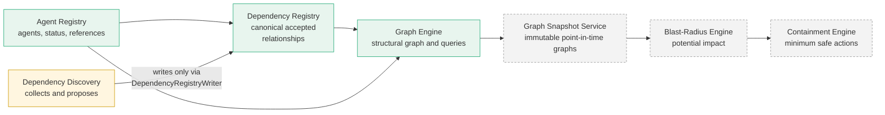

# Graph Engine

**Module:** Graph Engine (PRD "Module 4"; the legacy numbered file is [../03-graph-engine.md](../03-graph-engine.md))
**Phase:** 1, Core Security Engine
**Implementation status:** implemented and tested (`apps/api/src/modules/graph-engine`). Not production-ready: the API still uses the development-only authentication adapter.

## Documents

| Document | Contents |
|---|---|
| [architecture.md](architecture.md) | Components, data flow, trust boundaries, failure scenarios, diagrams |
| [data-model.md](data-model.md) | Nodes, edges, graph, identities, indexes, validation, serialization, a worked example |
| [algorithms.md](algorithms.md) | BFS, DFS, reachability, shortest path, bounded path enumeration, weak components, cycle detection |
| [api.md](api.md) | Every endpoint: parameters, validation, responses, errors, tenant isolation |
| [testing.md](testing.md) | Strategy, fixtures, what each suite proves, measured performance, acceptance criteria |
| [decisions.md](decisions.md) | Architecture decision records with alternatives and consequences |

## Purpose

CORVEN stores dependencies as individual records. A single record cannot answer the questions an incident raises: what is connected to what, in which direction, through which chain of relationships. The Graph Engine turns the canonical registry records into one directed, typed, **immutable in-memory graph** and answers structural questions about it:

- What does this node depend on, and what depends on it?
- Can A reach B, and by which paths?
- Which nodes form connected groups, and where are the cycles?

It is deterministic, tenant-isolated, bounded in the work it will do, and strictly read-only.

## Problem it solves

Compromising one agent can expose resources, delegated authority and downstream workflows through a chain of relationships. Records in a table do not show that chain. Without a graph, blast-radius analysis and containment planning would each have to re-derive connectivity themselves, inconsistently. The Graph Engine is the single place that does it.

## Responsibilities

| In scope (implemented) | Out of scope |
|---|---|
| Build a graph from agents, resources and dependencies of one organization | Creating or changing agents, resources or dependencies (registries own them) |
| Represent agents and resources as nodes, dependencies as directed typed edges, shared resources as one node | Discovering dependencies (Dependency Discovery) |
| Validate integrity and report invalid records without hiding the rest | Storing or versioning graphs (planned Graph Snapshot Service) |
| BFS, DFS, forward and reverse traversal, reachability, shortest path, bounded path enumeration | Classifying nodes as compromised or exposed (planned Blast-Radius Engine) |
| Weakly connected components and directed cycle detection | Calculating containment (planned Containment Engine) |
| Filters by entity type, node status, dependency type, edge status and confidence | Enforcing, revoking or approving anything |
| A serialisable export and an HTTP query API | Any LLM-based reasoning |

## Position in CORVEN

The chain of modules and what each one owns. Responsibilities are deliberately not merged.

| Module | Responsibility | State |
|---|---|---|
| Agent Registry | Authoritative inventory of agents: identity references, lifecycle status, capabilities | Built |
| Dependency Registry | **Stores canonical accepted** relationships with provenance, confidence, versions, evidence; validates every relationship; the only write path for dependencies | Built |
| Dependency Discovery | **Discovers and proposes** relationships from configurations, workflows and runtime events; never writes dependency tables directly | Partial (registry-side groundwork only) |
| **Graph Engine** | **Constructs and queries the structural graph** from canonical records; read-only | **Built** |
| Graph Snapshot Service | **Stores immutable point-in-time graph versions** so an incident is analysed against a fixed graph | Planned |
| Blast-Radius Engine | **Analyzes potential impact** over a graph: compromised, exposed, potentially affected, healthy, uncertain | Planned |
| Containment Engine | **Calculates minimum-safe containment actions** | Planned |

Direction of dependency: each module depends only on those to its left. The Graph Engine never imports a downstream module and never writes to a registry.

## Interfaces to other modules

| Interface | Direction | Use |
|---|---|---|
| Registry repositories (read-only, one `REPEATABLE READ` transaction) | Registries → Graph Engine | The only source of graph data (`RegistryGraphInputProvider`) |
| `GraphQueryService.build(organizationId)` | Graph Engine → internal callers | Returns an immutable `Graph`, a build report and the build duration |
| Pure query functions (`bfs`, `dfs`, `reachability`, `shortestPath`, `findPaths`, `weaklyConnectedComponents`, `detectCycles`, `exportGraph`) | Graph Engine → Blast-Radius, Containment, Snapshot | Operate on an immutable `Graph`; no database or HTTP involved |
| `exportGraph(graph, filter)` | Graph Engine → Snapshot Service | Plain JSON suitable for persistence (planned consumer) |
| `/api/v1/graph/*` | Graph Engine → operators, future dashboard | Read-only HTTP API ([api.md](api.md)) |

## Design principles

1. **The registry is the source of truth.** The graph is derived, never authoritative, never stored.
2. **Read-only.** The module only issues `SELECT`s, inside a read-only transaction.
3. **Deterministic.** Identical registry data and filters give identical results; collections are sorted.
4. **Directed.** Edge direction is the registry's source → target. The reverse is never assumed; `reverse` and `both` are explicit choices.
5. **Bounded.** Depth, path count, cycle count, search effort and graph size all have hard limits, and truncation is reported rather than hidden.
6. **Tenant-isolated.** One organization per graph, taken from the authenticated principal.
7. **Honest about meaning.** Structure only (see below).

## What a graph result does and does not mean

- **Reachability is structural.** It does not prove that an agent is compromised, that a path is exploitable, or that a permission can be revoked.
- **The graph contains registered dependencies only.** A dependency CORVEN never learned about is absent, and a recorded dependency may not be in use. Absence of an edge is not proof that no relationship exists. Source coverage and freshness are properties of discovery, not of the graph.
- **Confidence is returned as stored** (the strongest supporting evidence under a policy value), not a calibrated probability.

## Current implementation status

| Capability | Status |
|---|---|
| Graph construction, validation, immutability | Implemented |
| BFS, DFS, reachability, shortest path, bounded paths | Implemented |
| Weak components, cycle detection | Implemented |
| Filters (entity type, node status, dependency type, edge status, confidence) | Implemented |
| HTTP API (12 endpoints), tenant isolation | Implemented (dev-only authentication) |
| Performance measured at 1,000 nodes and 5,000 edges | Measured once; see [testing.md](testing.md) |
| Real authentication, caching, incremental update | Not implemented |
| Strongly connected components as an API result (used internally) | Not exposed |
| Graph Snapshot Service, blast radius, containment | Planned, separate modules |

Known limitations: [../../project/06-known-limitations.md](../../project/06-known-limitations.md). Related: [Agent Registry](../01-agent-registry.md), [Dependency Registry](../02-dependency-registry.md), [system architecture](../../architecture/01-system-architecture.md), [module architecture](../../architecture/03-module-architecture.md), [PRD](../../02-product-requirements.md).
