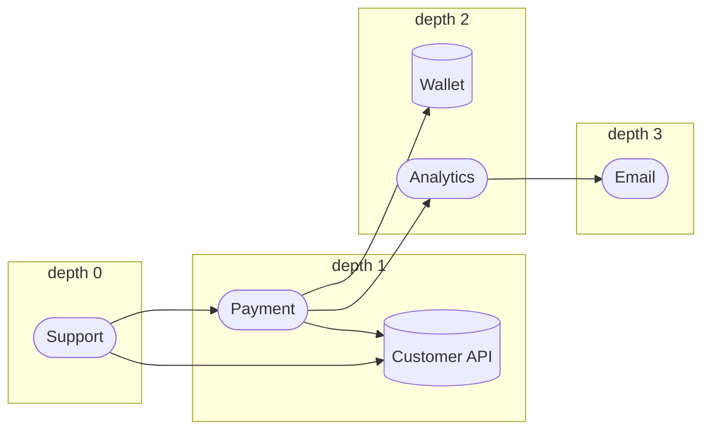
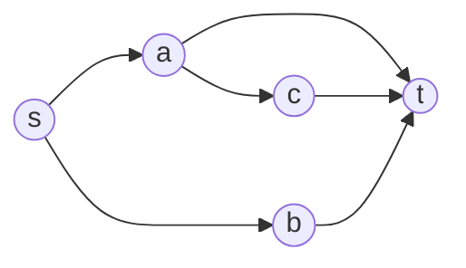

# Graph Algorithms

All algorithms are implemented in `apps/api/src/modules/graph-engine/core/` as pure functions over an immutable `Graph`. They share one compiled filter ([data-model.md](data-model.md#status-handling)) and one neighbour order, so results are deterministic. Notation: V nodes, E edges, `d` = depth limit.

## Common conventions

| Convention | Detail |
|---|---|
| Direction | `forward` follows edges source → target; `reverse` follows them backwards; `both` ignores direction (explicit opt-in) |
| Admissible step | An edge that passes the filter (dependency type, edge status, minimum confidence) **and** whose two endpoint nodes pass the node filters. By default only `active` edges are admissible |
| Neighbour order | Sorted by (neighbour id, edge id). This fixes the visiting order and tie-breaks |
| Limits | Traversal depth ≤ 100 (default 10); path depth ≤ 25; `maxPaths` ≤ 100 (default 10); `maxCycles` ≤ 500 (default 50); cycle length ≤ 50 (default 10); search budget 200,000 expansions |
| Truncation | When a bound stops a search, the result says so (`truncatedByDepth`, `truncated`, `truncationReason`). A bound is never silent |
| Errors | Unknown start node: `NODE_NOT_FOUND`. Over-limit request: `MAX_DEPTH_EXCEEDED` / `MAX_PATHS_EXCEEDED`. Bad filter: `INVALID_FILTER` |

Directed analyses (traversal, reachability, paths, cycles) respect edge direction. **Weakly connected components deliberately ignore direction** and must not be used to answer reachability. See [the last section](#directed-traversal-versus-weak-components).

The graph used in examples ("Acme" from [data-model.md](data-model.md#example-graph)): Support → Payment → Analytics → Email; Payment → Wallet; Payment, Support and Database → Customer API.

---

## 1. Breadth-first search (BFS)

**Purpose.** Visit all nodes reachable within a depth limit, level by level, recording the minimum number of hops to each.
**Input.** Graph, start node, `direction`, `maxDepth`, filter.
**Output.** `TraversalResult`: `visited` (node id, `depth`, `viaEdgeId`, `fromNodeId`), the sorted `edgeIds` examined, `truncatedByDepth`.

```text
BFS(G, start, direction, maxDepth, filter):
  require start in G, maxDepth in [0, 100]
  visited = {start};  queue = [(start, depth 0)]
  while queue not empty:
    (u, depth) = dequeue
    steps = admissible steps from u in direction (sorted)
    if depth >= maxDepth:
      if any step leads to an unvisited node: truncated = true
      continue                          // not expanded
    for each (edge, v) in steps:
      record edge
      if v not in visited:
        visited += v;  enqueue (v, depth + 1) with via = edge, from = u
  return visits, edges, truncated
```

**Complexity.** Time O(V + E); space O(V). With `maxDepth` only the nodes within it are touched.
**Edge cases.** Isolated start: only the start is returned. `maxDepth = 0`: only the start. Cycles: the visited set prevents repeats. Unknown start: `NODE_NOT_FOUND`.
**Limitations.** `depth` is the hop count under the chosen filter and direction. Edge multiplicity is not counted (a node is reached once).

**Example.** From Support, forward, `maxDepth = 3`:



Result: Support 0; Customer API 1 and Payment 1; Wallet 2 and Analytics 2; Email 3. The edge Payment → Customer API is examined but does not add a node, because the API was already reached at depth 1. With `maxDepth = 2`, `truncatedByDepth` is `true`: Analytics sits at the limit and still has the unvisited neighbour Email.

---

## 2. Depth-first search (DFS)

**Purpose.** Explore as deep as possible along each branch; same inputs and outputs as BFS.
**Input / output.** As BFS, with `algorithm: "dfs"`.

```text
DFS(G, start, direction, maxDepth, filter):                  // iterative
  best = {};  visits = [];  stack = [(start, depth 0)]
  while stack not empty:
    (u, depth, via, from) = pop
    if u in best:
      if best[u].depth <= depth: continue                    // already reached this shallowly
      update best[u] to (depth, via, from)                   // shallower route: re-expand
    else:
      best[u] = (depth, via, from);  append u to visits      // first discovery order
    if depth >= maxDepth: continue
    steps = admissible steps from u (sorted)
    for step in reverse(steps):                              // smallest neighbour pops first
      v = step.next
      if v not in best or best[v].depth > depth + 1:
        push (v, depth + 1, via = step.edge, from = u)
  truncated = any node at exactly maxDepth still has an unvisited admissible neighbour
```

**Complexity.** Time O(V + E) on typical graphs; worst case O(`maxDepth` · (V + E)) because a node may be re-expanded each time a shallower route is found (at most `maxDepth` times). Space O(V + E) for the stack and records.
**Why re-expansion.** A depth-limited DFS that marks nodes visited on first discovery can miss nodes that lie within the limit but were first reached along a deep path. Re-expanding on a shallower route fixes that: the visited set and the final `depth` of every node equal BFS's for the same limit. This was found by the performance test and is covered by a randomized BFS/DFS equivalence test ([testing.md](testing.md)).
**Edge cases.** As BFS. Visiting order is first-discovery pre-order, so it differs from BFS even though the depths agree.
**Iterative, not recursive.** An explicit stack means graph size cannot overflow the call stack. (The traversal depth is additionally capped at 100.)
**Limitations.** Costlier than BFS on dense graphs (measured: 134 ms versus 8 ms at 1,000 nodes and 5,000 edges, depth 100). Use BFS when only the reachable set and depths are needed.

**Example.** From Support, forward, smallest id first (agents sort before resources): Support, Payment, Analytics, Email, Customer API, Wallet. Customer API is first reached through Payment at depth 2, but Support also points at it directly: when that shallower route (depth 1) is popped, the node's depth is updated to 1 and it is expanded again. The final nodes and depths are the same as BFS's; only the visiting order differs.

---

## 3. Forward traversal

**Purpose.** Follow dependencies in their recorded direction: what does X depend on, delegate to or trigger, transitively.
**How.** BFS or DFS with `direction = "forward"` over `outgoingEdges`. It is the default.
**Example.** Forward from Payment: Analytics, Wallet, Customer API, then Email.
**Note.** Forward traversal never goes "up" an edge: starting from Email it reaches nothing.

## 4. Reverse traversal

**Purpose.** Follow edges backwards: what depends on, delegates to, or triggers X, transitively.
**How.** `direction = "reverse"` over `incomingEdges`. In the API, `neighbours?direction=incoming` uses it.
**Example.** Reverse from Customer API: Payment, Support, Database; then Support again is already visited; nothing else points at Support.
**Note.** Reverse is not the same as undirected: Email's reverse set is Analytics, Payment and Support, but not Wallet or Database.

---

## 5. Reachability

**Purpose.** Decide whether a directed path exists from A to B under a filter and depth limit.
**Input.** Source, target, `direction` (default `forward`), `maxDepth`, filter.
**Output.** `{ reachable, depth, truncatedByDepth }`.

```text
reachability(G, a, b, direction, maxDepth, filter):
  if a == b: return reachable, depth 0
  BFS from a; return reachable with depth the first time b is discovered
  if the queue empties: return not reachable
     truncatedByDepth = depth limit stopped any expansion with unvisited neighbours
```

**Complexity.** O(V + E) time, O(V) space; stops early when the target is found.
**Edge cases.** A node reaches itself (depth 0). Unknown source or target: `NODE_NOT_FOUND`.
**Limitations and meaning.** `reachable: false` with `truncatedByDepth: true` means "not found within the limit", not "unreachable". Reachability is **structural**: it says two registered entities are connected by registered dependencies. It does not mean the target is compromised, that the path is exploitable, or that CORVEN can revoke it. Dependencies CORVEN does not know about are not in the graph, so "not reachable" does not prove isolation in reality.
**Example.** Support → Email: reachable, depth 3. Email → Support forward: not reachable; with `direction=reverse`: reachable, depth 3. Support → Email filtered to `authority` only: not reachable (the chain uses `operational` edges).

---

## 6. Shortest-path discovery

**Purpose.** Find a path with the fewest edges from A to B, following edge direction. The graph is unweighted, so BFS suffices.
**Input.** Source, target, `maxDepth` (default 25), filter. **Output.** `GraphPath { nodeIds, edgeIds, length }` or `null`.

```text
shortestPath(G, a, b, maxDepth, filter):
  if a == b: return empty path [a]
  BFS from a forward, recording predecessor (node, edge) the first time each node is reached
  when b is reached: walk predecessors back to a, reverse, return
  if the queue empties: return null
```

**Complexity.** O(V + E) time, O(V) space.
**Determinism.** Neighbour order fixes the winner among equal-length paths: the one reached via the smallest ids first.
**Edge cases.** No path returns `null` (a normal result). Parallel edges: the smallest edge id is used. Not weighted: confidence and cost are not considered; weighted shortest paths are not implemented.
**Example.** Support → Email: `Support → Payment → Analytics → Email`, length 3.

---

## 7. Bounded path enumeration

**Purpose.** List simple paths (no repeated node) from A to B, shortest first, without ever enumerating an unbounded number.
**Input.** Source, target, `maxPaths` (default 10, ≤ 100), `maxDepth` (default 10, ≤ 25), filter.
**Output.** `PathSearchResult { found, shortest, paths, truncated, truncationReason }`, where `truncationReason` is `max_paths` or `search_budget`.

```text
findPaths(G, a, b, maxPaths, maxDepth, filter):
  shortest = shortestPath(a, b);  if none: return found = false
  dist[x] = hops from x to b following edge direction      // one reverse BFS
  for length L = shortest.length .. maxDepth:               // shortest paths first
    dive(a, remaining = L)
    stop once maxPaths + 1 paths are collected or the budget is spent

  dive(u, remaining):
    if remaining == 0: if u == b: record path; return
    for each admissible step (edge, v) from u in order:
      spend 1 unit of budget; stop everything if exhausted
      skip if v already on the current path                 // simple paths
      skip if dist[v] > remaining - 1                       // cannot reach b in time
      skip if v == b and remaining - 1 != 0                 // a simple path ends at its first arrival at b
      push v; dive(v, remaining - 1); pop

  if more than maxPaths found: keep maxPaths, truncated = true, reason max_paths
  else if budget exhausted:    truncated = true, reason search_budget
```

**Complexity.** The reverse BFS is O(V + E). The enumeration itself can be exponential on dense graphs, which is why it is **bounded by construction**: at most `maxPaths` results, depth ≤ `maxDepth`, and at most 200,000 expansions in total. Pruning by `dist` avoids exploring branches that cannot finish in time. Space O(V + E) plus the returned paths.
**Edge cases.** No path: `found: false`. Source equals target: the single trivial path. Cycles cannot cause repeated nodes. Parallel edges between the same two nodes give distinct paths. A dense layered graph with 4^11 paths returns exactly `maxPaths` quickly (tested).
**Limitations.** A truncated result is a **sample of the shortest paths**, not the complete set; it is always flagged. Only simple paths are listed. Only forward direction is supported. Paths are structural, not necessarily executable attack paths.
**Example.** In a diamond `s → a → t`, `s → b → t`, plus `a → c → t`: shortest paths first (`s>a>t`, `s>b>t`), then `s>a>c>t`.



---

## 8. Weakly connected components

**Purpose.** Group nodes that are joined by admissible edges when direction is **ignored**. A structural summary: which parts of the inventory are connected to each other at all.
**Input.** Filter (entity type, node status, dependency type, edge status, confidence). **Output.** A list of `{ index, nodeIds, edgeCount }`, deterministic.

```text
weaklyConnectedComponents(G, filter):
  nodes = nodes passing the node filter
  union-find over those nodes (path compression; the smaller id becomes the root)
  for each admissible edge: union(source, target)
  group nodes by root; edgeCount = admissible edges inside the group
  sort components by their smallest node id; each component's nodeIds sorted
```

**Complexity.** O((V + E) · α(V)) time (α is the inverse Ackermann function, effectively constant); space O(V).
**Edge cases.** Isolated nodes form their own components. Empty graph: no components. A node-type filter that removes all nodes returns none. Dropping an edge type can split a component.
**Limitations.** Components say nothing about direction, reachability or dependency semantics.
**Example.** In the Acme graph all seven nodes form one component. Add an agent with no dependencies and it becomes a second, one-node component. Filtering to `authority` edges leaves Support and Payment together and every other node isolated.

---

## 9. Directed cycle detection

**Purpose.** Find directed cycles, following edge direction. Reporting only: cycles are **not** automatically invalid. Operational cycles (A triggers B triggers A) can be legitimate; authority cycles are already rejected by the Dependency Registry.
**Input.** Filter, `maxCycles`, `maxLength`. **Output.** `CycleReport { cycles, cyclicComponentCount, truncated, truncationReason }`; each cycle lists its nodes (rotated to start at the smallest id) and edges.

```text
detectCycles(G, filter, maxCycles, maxLength):
  sccs = strongly connected components of the admissible graph      // iterative Tarjan, O(V + E)
  for each SCC with at least 2 nodes (or a self-loop):
    cyclicComponentCount += 1
    order = SCC nodes sorted by id
    for each start s in order:                                       // each cycle found once, from its smallest node
      DFS from s restricted to SCC nodes with rank >= rank(s), simple paths,
        cycle length <= maxLength
      when an edge returns to s: record the cycle
      stop at maxCycles + 1 cycles or when the 200,000-expansion budget is spent
  if more than maxCycles: keep maxCycles, truncated, reason max_cycles
  else if budget exhausted: truncated, reason search_budget
  sort cycles by length, then ids
```

**Complexity.** SCC detection O(V + E) time and O(V) space. Enumerating simple cycles can be exponential on dense strongly connected graphs, so it is **bounded** by `maxCycles` (≤ 500), `maxLength` (≤ 50) and the search budget. Tarjan is iterative, so a 20,000-node ring does not overflow the stack (tested).
**Edge cases.** DAG or empty graph: no cycles. An undirected loop (A→B, A→C, B→C) is not a directed cycle. Parallel edges produce distinct cycles (a→b via two dependencies and b→a gives two). Inactive edges are ignored by default. A mixed-type loop is not an operational cycle when the filter selects only `operational`.
**Limitations.** A strongly connected component whose every cycle is longer than `maxLength` is counted in `cyclicComponentCount` but yields no listed cycle. A truncated report is flagged and is not exhaustive. Strongly connected components are used internally and are not exposed as their own API result.
**Example.** Analytics triggers Payment in addition to Payment triggering Analytics: one cycle of length 2, `Analytics → Payment → Analytics`, with its two edges. `cyclicComponentCount` is 1.

---

## Directed traversal versus weak components

| | Directed traversal, reachability, paths, cycles | Weakly connected components |
|---|---|---|
| Edge direction | Respected (`reverse` and `both` are explicit) | **Ignored** |
| Question answered | What can be reached from here, by what path, with what cycles | Which nodes belong to the same connected group at all |
| Symmetric? | No: A reaches B does not mean B reaches A | Yes |
| Example (A → B) | A reaches B; B does not reach A | A and B are in the same component |

Two nodes in the same weak component may be unreachable from one another (Email cannot reach Support). Never answer "can X reach Y" from component membership.

Related: [architecture.md](architecture.md), [api.md](api.md), [testing.md](testing.md), [decisions.md](decisions.md).
