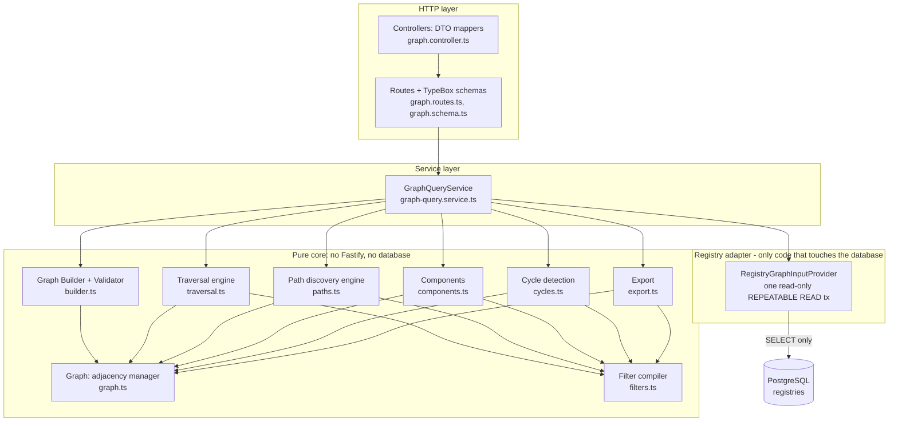
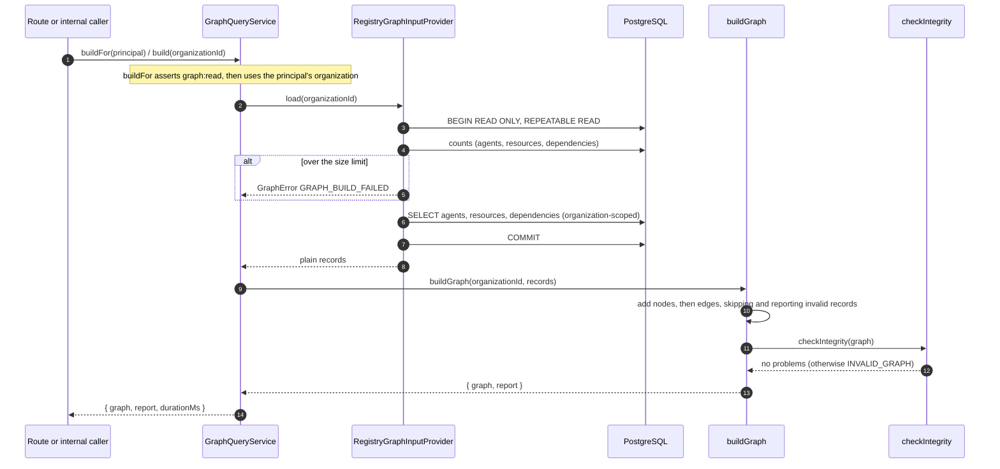
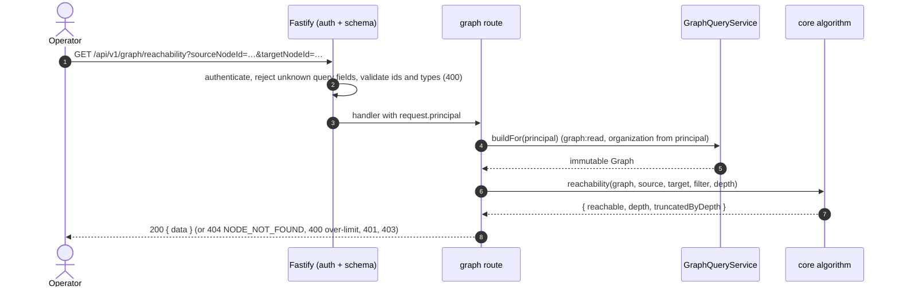
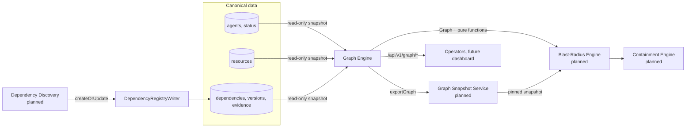

# Graph Engine Architecture

Describes the implemented structure of `apps/api/src/modules/graph-engine`. Overview: [README.md](README.md).

## Graph model

CORVEN uses a directed multigraph **G = (V, E)**.

- **V** is the set of agents and resources of one organization, one node per registered entity.
- **E** is the set of dependencies, one directed edge per dependency record. Two nodes may be joined by several edges (for example an `authority` and an `operational` dependency), so G is a multigraph.

An edge from A to B means A depends on, delegates to, or uses B **according to the recorded dependency type**. The meaning is never flattened: edges keep their `dependencyType`.

| Dependency type | Edge direction | Reads as |
|---|---|---|
| `authority` | delegator → delegate | A delegates authority to B |
| `resource` | agent → resource | A accesses or relies on resource B |
| `operational` | caller → callee | A needs or triggers B; implies no authority |

The reverse direction is not implied. Queries choose `forward` (follow edges), `reverse` (follow edges backwards) or `both` (ignore direction) explicitly.

A resource used by several agents is **one node** with several incoming edges. Removing one dependency never removes the shared resource node.

## Components

| Component | File | Responsibility |
|---|---|---|
| **Registry Repository Adapter** | `adapters/registry-graph-input.provider.ts` | Reads agents, resources and dependencies of one organization from the registry repositories in one read-only `REPEATABLE READ` transaction; checks size limits first; returns plain records. Never writes. Wraps failures into a generic `GRAPH_BUILD_FAILED` and keeps the cause for server-side logging only |
| **Graph Builder** | `core/builder.ts` (`buildGraph`) | Converts plain records into nodes and edges; skips and reports invalid records; optional strict mode; enforces the organization boundary |
| **Graph Validator** | `core/builder.ts` (`checkIntegrity`) | Final structural check: every edge has both endpoints, every node belongs to the graph's organization and has a consistent identity |
| **Adjacency Manager** | `core/graph.ts` (`Graph`) | Immutable node and edge indexes plus outgoing and incoming adjacency lists, pre-sorted so traversal is deterministic. No mutators |
| **Filter compiler** | `core/filters.ts` | Compiles one filter once; every algorithm applies it identically; supplies `stepsFrom` (admissible steps from a node in a direction) |
| **Traversal Engine** | `core/traversal.ts` | BFS, DFS (iterative), reachability |
| **Path Discovery Engine** | `core/paths.ts` | Shortest path, bounded enumeration of simple paths, `requirePath` |
| Structural analysis | `core/components.ts`, `core/cycles.ts` | Weakly connected components; strongly connected components (Tarjan) and bounded cycle enumeration |
| Export | `core/export.ts` | Frontend-agnostic plain JSON of nodes and edges |
| **Graph Query Service** | `services/graph-query.service.ts` | The stable interface: `build`, `buildFor(principal)`, and thin wrappers over the core functions; `overview(graph)` |
| HTTP | `routes/`, `schemas/`, `controllers/` | Request validation, authorization, DTO mapping, response envelopes |

Rules that keep the structure honest:

- `core/` imports nothing from Fastify or the database layer, so every algorithm is unit-tested with hand-built graphs.
- Only the adapter touches the database; the rest operates on plain records or the immutable `Graph`.
- The module never imports a downstream module (snapshot, blast radius, containment).

## Construction sequence

Why one transaction: the three reads are made inside a single snapshot, so a dependency created while the graph is being built cannot reference an agent the graph did not read.

## Graph query request flow

Every request rebuilds the graph; nothing is cached or stored (see [decisions.md](decisions.md), ADR-009). A "no path" answer is a normal `200`, never an error.

## Integration with surrounding modules

- Discovery proposes; the Dependency Registry validates and stores; the Graph Engine reads what was accepted.
- Today incident analysis would call `GraphQueryService.build` directly. When the Snapshot Service exists it will persist `exportGraph` output so that an incident is analysed against a fixed graph, and the Graph Engine's role does not change.
- The Graph Engine never classifies, plans, enforces or approves.

## Internal data flow summary

registry rows → plain records (adapter) → nodes and edges, report (builder) → immutable `Graph` with adjacency (adjacency manager) → compiled filter + algorithm → plain result → DTO → response. At no step is a registry row modified.

## Trust boundaries

| Boundary | Handling |
|---|---|
| HTTP client ↔ API | Authenticated principal; organization from the principal only; unknown query fields rejected; node ids pattern-checked (`agent:<uuid>` or `resource:<uuid>`) |
| API ↔ database | Read-only transaction; every query scoped by organization; one snapshot |
| Registry data ↔ builder | Treated as untrusted enough to validate: duplicates, dangling edges, other-organization records, bad types, bad confidence are skipped and reported |
| Graph ↔ consumers | `Graph` exposes frozen objects and copies; consumers cannot mutate the internal indexes |
| Error output | Generic messages for failures; causes only in server logs; build reports carry record ids and reasons, never record contents |

Security limits of this module: it relies on the registries for correctness of the data and on the authentication layer (development-only today) for who is calling.

## Failure scenarios

| Scenario | Behavior |
|---|---|
| Unknown node id in a query | `404 NODE_NOT_FOUND` |
| Node id of another organization | Same `404`: it does not exist in this organization's graph |
| Invalid filter value, malformed id, unknown query field | `400` |
| Requested limit above the cap (depth, paths, cycles) | `400 MAX_DEPTH_EXCEEDED` or `MAX_PATHS_EXCEEDED` |
| No path, not reachable | `200` with `found: false` / `reachable: false` |
| Search stopped by a bound (paths, cycles, depth) | `200` with `truncated` / `truncatedByDepth` and the reason |
| Invalid registry records (dangling edge, duplicate, wrong organization, bad confidence) | Skipped and listed in the build report; rest of the graph is built. Strict mode throws `INVALID_GRAPH` instead |
| Organization above 50,000 nodes or 250,000 edges | `500 GRAPH_BUILD_FAILED` |
| Database unavailable or query failure | `500 GRAPH_BUILD_FAILED`, generic message; cause logged server-side |
| Integrity check fails after construction | `500 INVALID_GRAPH` (indicates a bug) |
| Caller without `graph:read` | `403` |
| Unauthenticated | `401` |

Registered-data limits that no failure handling can remove: dependencies CORVEN does not know about are missing from the graph, so a graph with no path between two nodes does not prove that none exists in reality.

## Concurrency

The graph is immutable and per-request; requests share nothing. Writers to the registries are not blocked, because the builder reads from a `REPEATABLE READ` snapshot. Two builds a moment apart can differ if the registries changed in between.
