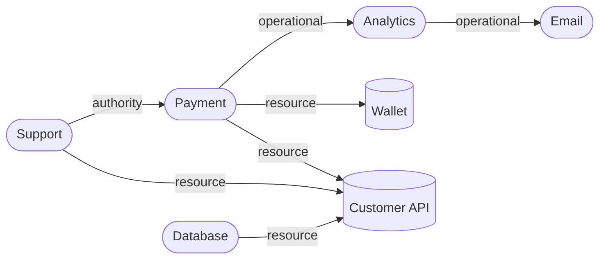

# Graph Data Model

The types below are the implemented ones from `apps/api/src/modules/graph-engine/types/graph.types.ts`, with the registry mapping made explicit. Values are lowercase to match the registries (`agent`, `authority`, `active`). Overview: [README.md](README.md); structure: [architecture.md](architecture.md).

## Identity strategy

| Item | Identity | Why |
|---|---|---|
| **Node** | `agent:<uuid>` or `resource:<uuid>` (the registry uuid with an entity prefix) | Agents and resources live in different tables, so their uuids are not guaranteed distinct. The prefix makes the id unambiguous and lets an id be validated by pattern |
| **Edge** | The dependency's uuid (`id` equals `dependencyId`) | Dependencies are unique per ordered pair and type, but a pair may carry several types, so the pair alone is not an edge id |
| Entity lookup | `getNodeByEntity(entityType, entityId)` | Resolve from a registry id without parsing strings |

Ids are never derived from mutable names. Names are display data.

## `GraphNode`

```ts
interface GraphNode {
  readonly id: string;                 // "agent:<uuid>" | "resource:<uuid>"
  readonly organizationId: string;
  readonly entityType: "agent" | "resource";
  readonly entityId: string;           // the registry uuid
  readonly name: string;
  readonly status: string | null;      // agent lifecycle status; null for resources
  readonly subtype: string;            // agentType or resourceType
  readonly externalReference: string | null;
}
```

| Field | Registry source |
|---|---|
| `entityId`, `organizationId`, `name`, `externalReference` | `agents` or `resources` |
| `status` | `agents.status` (`active`, `suspended`, `compromised`, `inactive`). Resources have no status, so `null` |
| `subtype` | `agents.agent_type` (`llm`, `workflow`, `service`, `wallet`, `other`) or `resources.resource_type` (`api`, `database`, `wallet`, `credential`, `storage`, `service`, `workflow`, `mcp_server`, `queue`, `other`) |

Nodes are included regardless of status. A `compromised` or `inactive` agent stays in the graph, because that is when its connections matter. Status is available to filters, not used to drop nodes.

The graph never creates an entity that does not exist in a registry.

## `GraphEdge`

```ts
interface GraphEdge {
  readonly id: string;                 // = dependencyId
  readonly dependencyId: string;
  readonly sourceNodeId: string;
  readonly targetNodeId: string;
  readonly dependencyType: "authority" | "resource" | "operational";
  readonly relationship: string;       // label, e.g. "accesses"
  readonly status: "active" | "inactive";
  readonly confidence: number;         // 0 to 1
  readonly provenance: Readonly<Record<string, unknown>>;
  readonly metadata: Readonly<Record<string, unknown>>;
  readonly version: number;
  readonly createdAt: Date;
  readonly updatedAt: Date;
}
```

| Field | Meaning and registry source |
|---|---|
| `sourceNodeId`, `targetNodeId` | Built from `dependencies.source_type/source_id` and `target_type/target_id`. Direction is preserved exactly |
| `dependencyType` | `authority` (delegator → delegate), `resource` (agent → resource), `operational` (caller → callee). Preserved on the edge and never merged |
| `relationship` | Free label from the registry (lowercase, `a-z0-9_.:-`) |
| `status` | `active` or `inactive`. Inactive edges are in the graph but excluded from queries unless asked for |
| `confidence` | The registry's stored value: the strongest confidence among the dependency's evidence. A policy value of evidence strength, **not** a calibrated probability |
| `provenance` | The registry's single summary of the first accepted source (`{ source, reference?, note? }`). The full evidence history is **not** attached to graph edges; it is available from `GET /api/v1/dependencies/:id/evidence` |
| `metadata` | Registry metadata, for example `scope` on authority edges and `accessLevel` on resource edges. Already guarded against secret-looking keys by the registry |
| `version` | Dependency version at build time |

## `Graph`

An immutable class (`core/graph.ts`), constructed by `buildGraph`. There are no mutators.

```ts
class Graph {
  readonly organizationId: string;
  readonly metadata: Readonly<{ nodeCount: number; edgeCount: number; builtAt: Date }>;
  hasNode(id): boolean;
  getNode(id): GraphNode | undefined;
  getNodeByEntity(entityType, entityId): GraphNode | undefined;
  getEdge(id): GraphEdge | undefined;
  nodes(): readonly GraphNode[];            // sorted by id
  edges(): readonly GraphEdge[];            // sorted by id
  outgoingEdges(nodeId): readonly GraphEdge[];  // sorted by (target id, edge id)
  incomingEdges(nodeId): readonly GraphEdge[];  // sorted by (source id, edge id)
}
```

The PRD sketches a `Graph` type with public `Map` fields. The implementation keeps the maps private so callers cannot corrupt them, and exposes methods instead. Public behavior matches the PRD.

## Adjacency indexes

| Index | Structure | Use |
|---|---|---|
| Node lookup | `Map<nodeId, GraphNode>` | `getNode`, `hasNode` |
| Entity lookup | `Map<"type:entityId", GraphNode>` | `getNodeByEntity` |
| Edge lookup | `Map<edgeId, GraphEdge>` | `getEdge` |
| Outgoing adjacency | `Map<nodeId, readonly GraphEdge[]>` | Forward traversal |
| Incoming adjacency | `Map<nodeId, readonly GraphEdge[]>` | Reverse traversal and incoming queries |

Adjacency stores edge objects shared with the edge index (no copies). Lists are sorted at build time by (neighbour id, edge id), so traversal order is deterministic and no algorithm scans the whole edge set. Memory is O(V + E).

## Plain inputs

The builder takes plain records, decoupled from the database and the registry classes, so it can be tested without either:

```ts
interface GraphInput {
  agents: readonly { id; organizationId; name; status; agentType; externalReference }[];
  resources: readonly { id; organizationId; name; resourceType; externalReference }[];
  dependencies: readonly { id; organizationId; sourceType; sourceId; targetType; targetId;
                           dependencyType; relationship; status; confidence;
                           provenance; metadata; version; createdAt; updatedAt }[];
}
```

## Validation rules

`buildGraph(organizationId, input, { strict? })` checks every record. Invalid records are skipped and reported (default) or fail the build (`strict`, `INVALID_GRAPH`). Reports contain the record id, a code and a fixed message, never record contents.

| Code | Rule |
|---|---|
| `CROSS_TENANT_REFERENCE` | A node or edge belongs to a different organization: never included |
| `DUPLICATE_NODE` | Two records produce the same node id |
| `DUPLICATE_EDGE` | Two dependency records with the same id |
| `INVALID_ENDPOINT_TYPE` | An edge endpoint type is not `agent` or `resource` |
| `INVALID_DEPENDENCY_TYPE` | Not `authority`, `resource` or `operational` |
| `INVALID_STATUS` | Not `active` or `inactive` |
| `INVALID_CONFIDENCE` | Not a number in [0, 1] |
| `DANGLING_EDGE` | Source or target node is not in this graph |

Size limits: more than 50,000 nodes or 250,000 edges fails with `GRAPH_BUILD_FAILED`. After construction `checkIntegrity` verifies that every edge has both endpoints and every node belongs to the graph's organization with a consistent id.

The database already enforces most of these rules (composite foreign keys, CHECK constraints), so reported issues should be rare. The builder's checks protect against inconsistent reads and data changed outside the application.

## Status handling

| Entity | Rule |
|---|---|
| Node status | Informational and filterable (`nodeStatuses`). Resources have `null` status, so a node-status filter excludes resources |
| Edge status | `active` by default. `edgeStatuses: ["inactive"]` or both can be requested (`includeInactive=true` in the API). Inactive edges never count unless requested |
| Edge excluded by node filters | An edge is admissible only if **both** endpoint nodes pass the node filters |

## Confidence and provenance

- Confidence is a number in [0, 1] describing the strength of the evidence behind a dependency. `minConfidence` filters edges below a threshold.
- The engine does not combine, decay or recompute confidence. It reports what the registry stored.
- Provenance is the registry's summary only; see `GraphEdge` above.
- Neither value establishes that the relationship is currently exercised.

## Serialization format

`exportGraph(graph, filter?)` returns plain JSON with stable ordering and ISO dates; the API returns it from `GET /api/v1/graph/export`. It has no internal indexes and is not tied to a frontend library, so a UI or the future Snapshot Service can consume it.

```json
{
  "organizationId": "00000000-0000-4000-8000-0000000000aa",
  "builtAt": "2026-11-06T09:30:00.000Z",
  "nodes": [ { "id": "agent:…", "organizationId": "…", "entityType": "agent",
               "entityId": "…", "name": "Support", "status": "active",
               "subtype": "llm", "externalReference": "support-agent" } ],
  "edges": [ { "id": "…", "dependencyId": "…",
               "sourceNodeId": "agent:…", "targetNodeId": "agent:…",
               "dependencyType": "authority", "relationship": "delegates_authority",
               "status": "active", "confidence": 1,
               "provenance": { "source": "manual" },
               "metadata": { "scope": "payment.execute" },
               "version": 1,
               "createdAt": "2026-11-06T09:00:00.000Z", "updatedAt": "2026-11-06T09:00:00.000Z" } ]
}
```

Nodes and edges are sorted by id. Filters (entity type, dependency type, edge status, confidence) apply to the export.

## Example graph

Illustrative data ("Acme"; ids shortened for readability). Agents: Support, Payment, Analytics, Email, Database. Resources: Customer API (shared), Payment Wallet.

| Edge (source → target) | `dependencyType` | `relationship` | Metadata |
|---|---|---|---|
| Support → Payment | `authority` | `delegates_authority` | `scope: payment.execute` |
| Payment → Analytics | `operational` | `triggers` | |
| Analytics → Email | `operational` | `triggers` | |
| Payment → Wallet | `resource` | `accesses` | `accessLevel: write` |
| Payment → Customer API | `resource` | `accesses` | `accessLevel: read` |
| Support → Customer API | `resource` | `accesses` | `accessLevel: read` |
| Database → Customer API | `resource` | `accesses` | `accessLevel: read` |



- 7 nodes, 7 edges. The Customer API is **one** node with three incoming edges.
- `outgoingEdges(agent:payment)` has two edges; `incomingEdges(resource:api)` has three.
- Reachability is directional: Support reaches Email (three edges); Email does not reach Support.
- Removing the Payment → Customer API dependency (making it inactive) leaves the Customer API node and its other two edges untouched.

## Consistency with the registries

| Graph field | Registry | Check |
|---|---|---|
| Node and edge types, statuses | Same enumerations as [Agent Registry](../01-agent-registry.md) and [Dependency Registry](../02-dependency-registry.md) | Builder rejects anything else |
| Edge direction | `source_*` → `target_*` | Never swapped |
| Uniqueness | One dependency per ordered pair and type | Duplicates reported, never merged |

Related: [algorithms.md](algorithms.md), [api.md](api.md).
