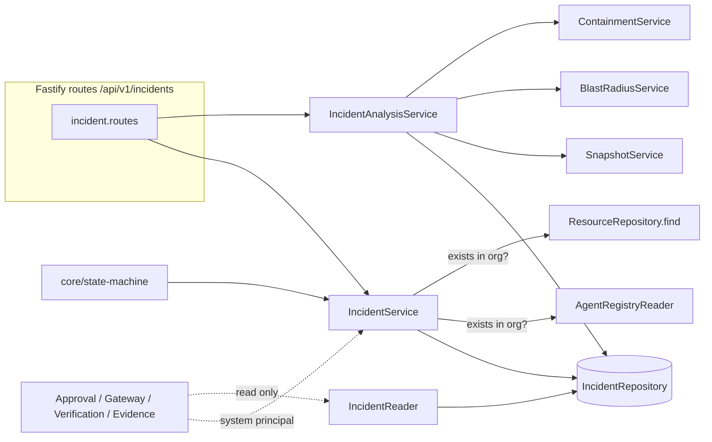

# Incident Management: architecture

## Components

- **IncidentService** creates and updates incidents, runs transitions, manages associations, assignment and notes, and records external events.
- **IncidentAnalysisService** attaches snapshot, blast-radius and containment-plan references by calling the existing Phase 1 services. It contains no analysis logic.
- **core/state-machine.ts** is pure data plus lookups, tested without a database.
- **IncidentReader** is the read-only, organization-explicit interface for later modules (same style as `AgentRegistryReader`).
- Registry access goes through two narrow ports, `AgentLookup` and `ResourceLookup`, so the module does not touch registry internals or tables.

## Analysis references instead of copies

Phase 1 engines return results and store nothing. The incident therefore stores a reference:

| Kind | Stored | Not stored |
|---|---|---|
| `graph_snapshot` | snapshot id, content hash, build time, format version, counts | the graph |
| `blast_radius` | snapshot id and hash, engine input (sources, thresholds, `analysedAt`), canonical hash of the result, summary counts | the full result |
| `containment_plan` | same, plus `planHash` and plan status, cost, action count, approval flags | the full plan |

Both engines are deterministic over an immutable snapshot, so `GET .../analysis/:referenceId/verify` re-runs the engine on the pinned snapshot with the stored input (including the stored `analysedAt` used as "now") and compares the result hash. A mismatch, or a snapshot that no longer matches its hash, is reported as not reproducible.

The creating response returns the full result once, so a caller can show it. It can always be regenerated.

Rules:
- A snapshot must be attached before blast radius or a plan.
- Attaching a new snapshot clears the incident's *current* blast-radius and plan pointers (older references stay in history), because both were computed on the previous graph.
- Analysis is allowed in `detected`, `investigating`, `containment_planned`, `rejected`, `partially_contained` and `containment_failed`. Plans are not allowed from `detected`, and are locked once approval is requested.
- The pinned snapshot's hash is re-verified every time it is used.

## Why no background jobs

Every incident operation is a short transactional write, and the callers of the later modules need the result immediately (for example, an approval must see the new state before it proceeds). A queue would add retries and ordering problems for no benefit. Idempotency is provided where it matters instead:

- signals from detection sources are deduplicated on `(organization, source, detectionReference)`;
- internal transitions and events take an idempotency key and are no-ops on replay;
- concurrent changes to one incident serialize on a row lock.

pg-boss (already used by Discovery) remains the right tool for the later orchestrator; the module is designed so that a worker can call these services as the `system` principal.

## Transactions and concurrency

Every mutation runs in one transaction that locks the incident row (`SELECT ... FOR UPDATE`), re-checks the state, writes the change, the state-history row where relevant, the timeline event and the audit row, and bumps `version`. A failure anywhere rolls back all of it. Analysis is computed outside the transaction and the snapshot pointer is re-checked under the lock; if the snapshot changed meanwhile the request fails with `SNAPSHOT_CHANGED` instead of attaching a stale result.

## Correlation

HTTP callers may send `x-correlation-id` (letters, digits and `._:-`, up to 100 characters); otherwise the request id is used. It is stored on state history, timeline events and audit rows.
