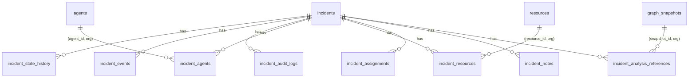

# Incident Management: data model

Migrations `0010_incident_management` and `0011_incident_append_only` (down scripts in `drizzle/down/`). Every table carries `organization_id` with composite foreign keys `(id, organization_id)`, so a row can never reference another organization's entity. There are no cascading deletes; incidents are never hard-deleted.

| Table | Mutable? | Purpose |
|---|---|---|
| `incidents` | **yes** (current state only) | Title, description, severity, status, detection source and reference, creator and type, assignee, `state_entered_at`, `version`, and the ids of the current snapshot, blast-radius and plan references. Unique `(id, organization_id)`; partial unique `(organization_id, detection_source, detection_reference)` for signal idempotency |
| `incident_state_history` | append-only | One row per transition: from, to, actor, actor type, reason, correlation id, idempotency key (unique per incident when set) |
| `incident_events` | append-only | The timeline. `seq` (identity) gives a stable total order; `event_type`, actor, `data` jsonb, correlation id, idempotency key |
| `incident_audit_logs` | append-only | Action, target type and id, before and after state, actor, correlation id |
| `incident_agents` | append-only | Agent association: relationship (`compromised`, `affected`, `dependent`, `observed`, `preserved`), `suspected_compromised`, impact (`direct`, `indirect`, `none`), source, source reference. Unique `(incident, agent, relationship)` |
| `incident_resources` | append-only | Resource association: relationship (`exposed`, `affected`, `protected`, `observed`), impact classification, resource type copied from the registry at association time |
| `incident_assignments` | append-only | Assignment history; the current assignee is on the incident row |
| `incident_notes` | append-only | Notes (1 to 4000 characters). Never edited; a correction is a new note |
| `incident_analysis_references` | append-only | Kind, per-kind `version`, snapshot id/hash/build time/format version, engine version, input, result hash, plan hash and status, summary |

## Constraints

CHECKs on status, severity, detection source, actor type, relationship values, impact values, non-blank title and note, hash format, and `(kind = 'containment_plan') = (plan_hash is not null)`.

## Append-only enforcement

`corven_reject_mutation()` (SQLSTATE 23001) rejects `UPDATE`, `DELETE` and `TRUNCATE` on all eight history tables. `graph_snapshots` is now also referenced by a foreign key, so `TRUNCATE` on it is refused earlier by PostgreSQL itself (`0A000`); it still cannot be truncated. A database superuser can still disable triggers, as for every append-only table in CORVEN.

## Retention

Nothing is deleted. There is no retention policy yet.
