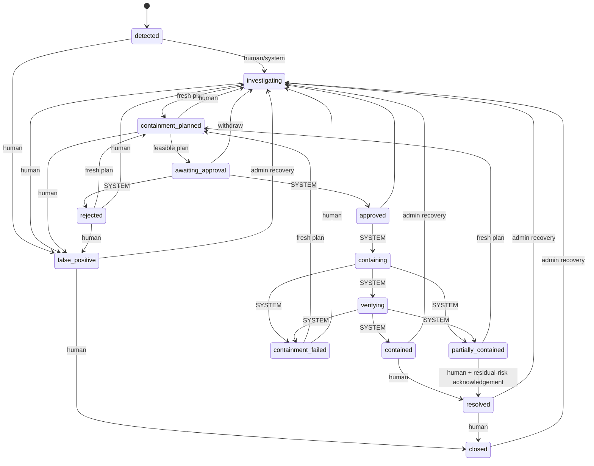

# Incident lifecycle

Implemented in `core/state-machine.ts` and enforced by `IncidentService.transition`. There is no generic status update: `PATCH` rejects `status`.

## Who may make a transition

| Actor | Meaning | Transitions |
|---|---|---|
| `human` | an authenticated admin or operator | analysis-side moves: investigate, plan, request approval, withdraw, mark false positive, resolve, close |
| `system` | a trusted internal module | approval result, enforcement and verification outcomes |
| admin (`incident:recover`) | explicit recovery | anything leaving `contained`, `resolved`, `false_positive` or `closed` back to `investigating` |

`system` cannot be obtained over HTTP; the dev authenticator rejects `x-dev-role: system` and a test asserts it. A person attempting a system-only transition gets `403 TRANSITION_NOT_PERMITTED`; an edge that does not exist gets `409 INVALID_INCIDENT_TRANSITION` listing the allowed targets.

## Guards

| Guard | Applies to | Rule |
|---|---|---|
| `fresh_plan` | entering `containment_planned` | The incident's current plan reference must exist and have been generated **after** the incident entered its current state, on the current snapshot. Each planning cycle needs a new plan (`CONTAINMENT_PLAN_REQUIRED`, `CONTAINMENT_PLAN_STALE`) |
| `feasible_plan` | entering `awaiting_approval` | The current plan's status must be `feasible` (`PLAN_NOT_FEASIBLE`). Infeasible and no-action plans cannot be sent for approval |
| `residual_risk_acknowledged` | `partially_contained -> resolved` | Body must set `acknowledgeResidualRisk: true`; recorded on the timeline |

Every transition also requires a non-empty `reason` (at most 1000 characters, no credentials). `expectedStatus` gives an optimistic check (`409 STALE_INCIDENT_STATE`).

## Invariants

- `contained` is reachable only from `verifying`. Submitting actions (`containing`) can never be `contained`.
- `containment_failed` cannot lead to `contained` without a new plan, new approval and a new run.
- `partially_contained` is distinct and cannot jump to `contained`.
- `resolved` is reachable only from `contained`, or from `partially_contained` with acknowledged residual risk.
- Closing deletes nothing: state history, timeline, audit, notes and references persist. A closed incident rejects every change (`409 INCIDENT_CLOSED`) except late internal events (for example evidence) and an admin reopen.
- Generating a plan never changes the lifecycle state. Requesting approval records `approval.requested` with the plan hash.

## Properties tested without a database

`test/incident-core.test.ts` checks that every status is defined and reachable from `detected`, that no edge is duplicated or points at itself, that all trusted-fact transitions are system-only, and the invariants above.
