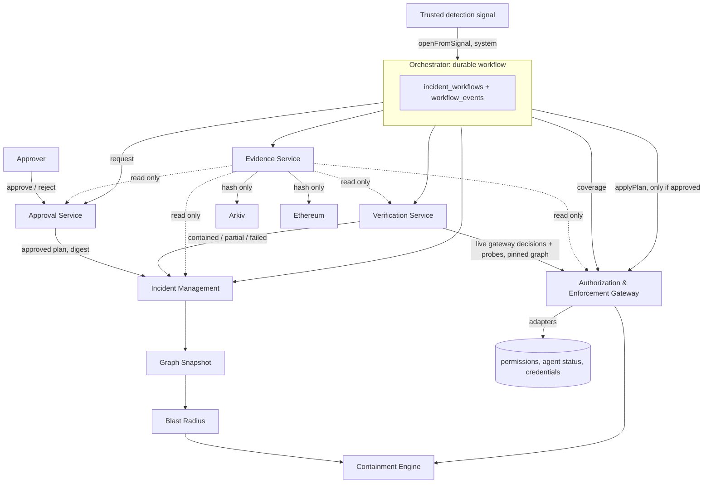

# Phase 2 architecture



## End-to-end sequence

```mermaid
sequenceDiagram
  participant D as Detection (trusted)
  participant O as Orchestrator
  participant I as Incident
  participant A as Approval
  participant P as Person
  participant G as Gateway
  participant V as Verification
  participant E as Evidence
  D->>O: signal (idempotent)
  O->>I: create incident, compromised agents; start workflow
  O->>I: snapshot, blast radius, plan (with gateway coverage)
  O->>A: request approval (plan digest)
  A->>I: awaiting_approval
  P->>A: approve exact plan
  A->>I: approved
  O->>G: applyPlan (re-verifies approval and plan)
  G-->>O: per-action results (executed / failed / unsupported)
  O->>V: verify
  V->>G: live decisions + probes
  V->>I: contained | partially_contained | containment_failed
  O->>E: generate (sealed, chained) and anchor (hash only)
```

## Trust boundaries

| Boundary | Rule |
|---|---|
| People | Firebase sign-in (see docs/saas/07-human-authentication.md); development authenticator for local use. Roles decide who may request, approve, enforce, anchor |
| Internal modules | The `system` principal, unobtainable over HTTP. Each module uses a fixed audit identity |
| Agents | Machine tokens only; never a human or wallet credential |
| Evidence and anchors | Content never leaves CORVEN; only a hash and identifiers are anchored |

## Module map

| Module | Docs | Status |
|---|---|---|
| Incident Management | [../incident-management/](../incident-management/README.md) | Built |
| Authorization & Enforcement Gateway | [../authorization-enforcement/](../authorization-enforcement/README.md) | Built; executors simulated |
| Approval Service | [../approval-service/](../approval-service/README.md) | Built |
| Verification Service | [../verification-service/](../verification-service/README.md) | Built; probes use simulated executors |
| Evidence Service | [../evidence-service/](../evidence-service/README.md) | Built; Arkiv/Ethereum behind interfaces, test doubles only |
| Orchestration | this folder | Built |
