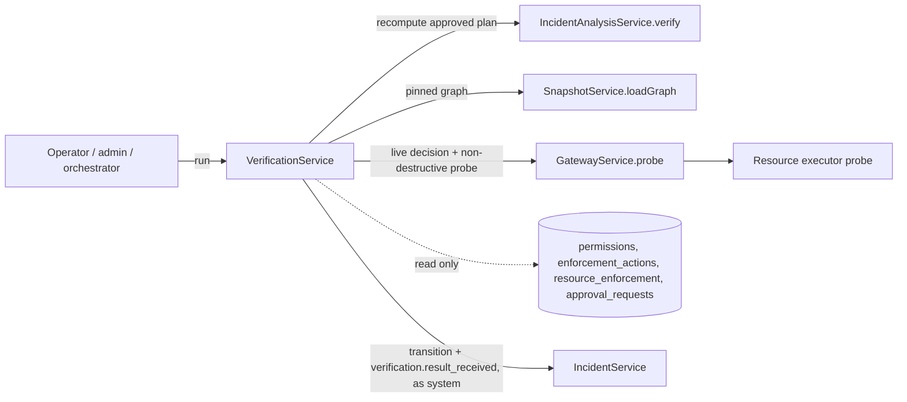

# Verification: architecture



Verification reads the gateway's and approval's tables directly, read only, on purpose: it must observe the resulting state, not ask the module whose work it is checking. It never writes to them.

## Run flow

```mermaid
sequenceDiagram
  participant C as Caller
  participant V as Verification
  participant I as Incident
  participant G as Gateway
  C->>V: POST /verification/run {incidentId}
  V->>I: incident containing or verifying? approved current plan?
  V->>V: create run (pending; one active per incident)
  V->>I: containing -> verifying (system)
  V->>V: recompute plan on pinned snapshot
  loop each check
    V->>G: probe(agent, resource, action)
    G-->>V: live decision (+ resource probe if allowed)
  end
  V->>V: store checks, result hash, status (one transaction)
  V->>I: verifying -> contained | partially_contained | containment_failed (system); event verification.result_received
```

| Run status | Incident |
|---|---|
| `passed` | `contained` |
| `partially_verified` | `partially_contained` |
| `failed` | `containment_failed` |
| `inconclusive` | stays `verifying`; retry |

## Retries and recovery

- Only an `inconclusive` run can be retried (`POST /verification/:id/retry`): a final result is not re-rolled. At most 3 attempts per chain. A retry reuses the same inputs and is idempotent (`retry:<runId>`).
- A failing probe makes only that check inconclusive, marked `transient`.
- If updating the incident fails after a run completes, the run keeps `incident_synced = false` and `runMaintenance()` completes it; transitions and events use idempotency keys derived from the run id.
- Runs execute synchronously within the request. A crash mid-run leaves a `running` row that blocks new runs for that incident; clearing stale runs is part of the orchestration stage.
