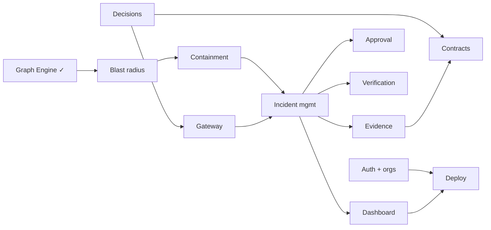

# Implementation Roadmap

Documentation-first and module by module, with core graph analysis and containment as the priority (PRD section 15). Status as of 6 November 2026.

## Phases

| Phase | Scope | State |
|---|---|---|
| 1. Product and architecture | PRD, use cases, scope, domain and graph model, service boundaries, threat model | Done as documents (this folder); C4 model in IcePanel |
| 2. Core backend | Agent registry, dependency registry, graph engine, incident management, blast radius, containment | **Done** (Phase 1 engines and Incident Management) |
| 3. Enforcement | Gateway, permission evaluation, approval, revocation, verification | **Done** with simulated resource executors; orchestration connects the modules |
| 4. Blockchain integrations | Solidity contracts, Sepolia, ENS, Arkiv, Chainlink CRE (if feasible) | Not started. Evidence anchoring exists behind interfaces with test doubles; no contract, signer, Arkiv client or live ENS resolution |
| 5. Evidence and dashboard | Evidence generation and verification, graph UI, incident UI, approval UI, evidence viewer | Not started (landing page done) |
| 6. Deployment and validation | Docker, AWS, Vercel, database, CI/CD, security testing, end-to-end demo | Not started (local Docker Compose only) |

Discovery, graph snapshots, the Blast-Radius Engine and the Containment Engine are implemented and tested (502 tests). Phase 2 (incident management, gateway, approval, verification, evidence, orchestration) is implemented and tested (see the module documents); what remains is real integrations (resource executors, Arkiv, Ethereum signing, live ENS), real human authentication, and a dashboard.

## Completed so far

1. Foundation: pnpm workspace, Fastify API, Drizzle, Vitest on real PostgreSQL, local PostgreSQL via Docker.
2. **Agent Registry** (merged): lifecycle with controlled recovery, capabilities, identities, append-only history and audit.
3. **Dependency Registry** (merged): typed dependencies, authority cycle prevention, versioning, shared resources.
4. **Discovery prerequisites** (merged): external references, append-only evidence, internal writer, graph data provider, `system` principal.
5. **Graph Engine** (committed on `feature/graph-engine`, PR pending): immutable graph, traversal, paths, components, cycles, API, measured performance.
6. Landing page (`apps/landing`).
7. Documentation (this folder).

## Remaining work, in a suggested order

| # | Work | Why this order |
|---|---|---|
| 1 | **Real authentication and organizations** | Everything inherits this boundary; the API cannot be deployed without it |
| 2 | Resolve the open architecture decisions (gateway placement, permission source of truth, CRE direction, signing key) | They shape modules 4 to 7 and the contracts |
| 3 | **Blast-Radius Engine** | Small, pure, builds directly on the graph |
| 4 | **Containment Engine** (algorithm doc first, then max-flow core, then planner) | The central differentiator and the largest risk; start early |
| 5 | Incident Management | Orchestrates 3 and 4 |
| 6 | Authorization Gateway and enforcement adapters (in-memory first) | Gives containment something to enforce |
| 7 | Approval, Verification | Complete the safety story |
| 8 | Evidence Service (hash chain, signing) | Needs the key decision |
| 9 | Contracts + Ethereum adapter, then ENS, then Arkiv, then CRE if time allows | Integrations behind adapters, each independently testable |
| 10 | Remaining discovery: sources, adapters (configuration and workflow first, gateway last), normalization, resolution, reconciliation, review | Valuable but not on the critical path of the demo |
| 11 | Dashboard (graph, incident, approval, evidence) | Needs stable APIs |
| 12 | CI, deployment, end-to-end demo, demo video | Throughout, and a final pass |

## Dependency graph between the remaining items

## Risks and mitigations (from the PRD, updated)

| Risk | Mitigation |
|---|---|
| Scope too large for solo development | Priorities above; cutting order in [04-mvp-scope.md](../04-mvp-scope.md) |
| Containment calculation incorrect | Pure deterministic engine; brute-force comparison tests; re-verification of every plan |
| Integration complexity (chain, ENS, Arkiv, CRE) | Adapters; fakes for tests; CRE cut first |
| ENS does not control external permissions | Tie identity to an actual enforcement path or keep its role honest |
| Incomplete visibility | Track uncertainty; coverage and freshness reported |
| Cloud cost | Small infrastructure, budget alerts |
| Authentication gap | Item 1 above; no public deployment before it |

## Rules for the schedule

Core graph, containment and verification come first. Any item can slip except tenant isolation, honest verification and the limitations section.
